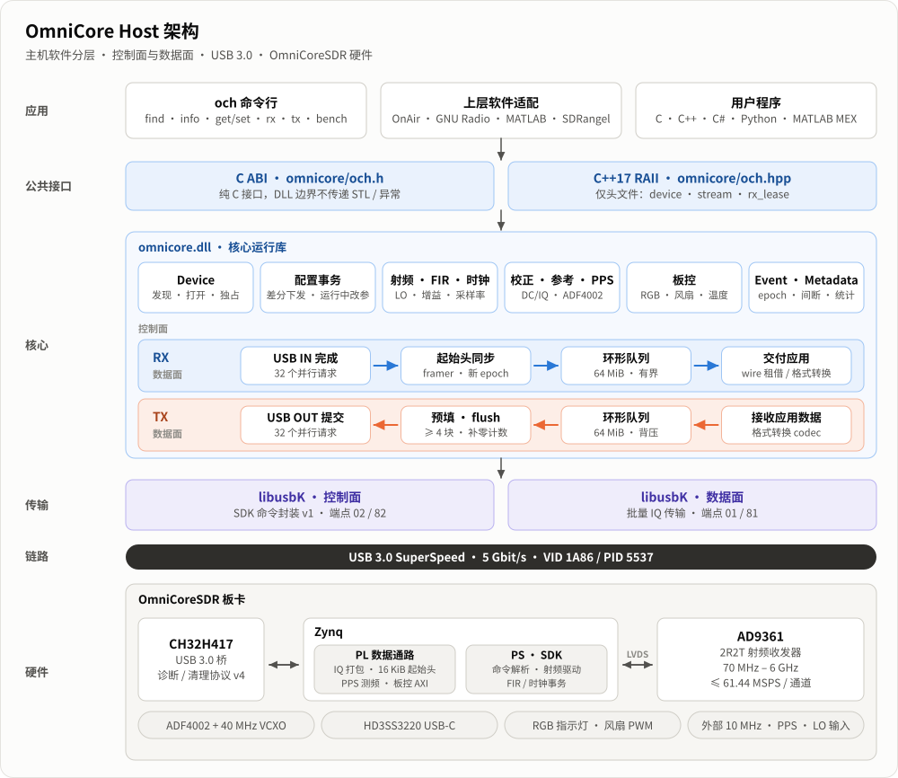
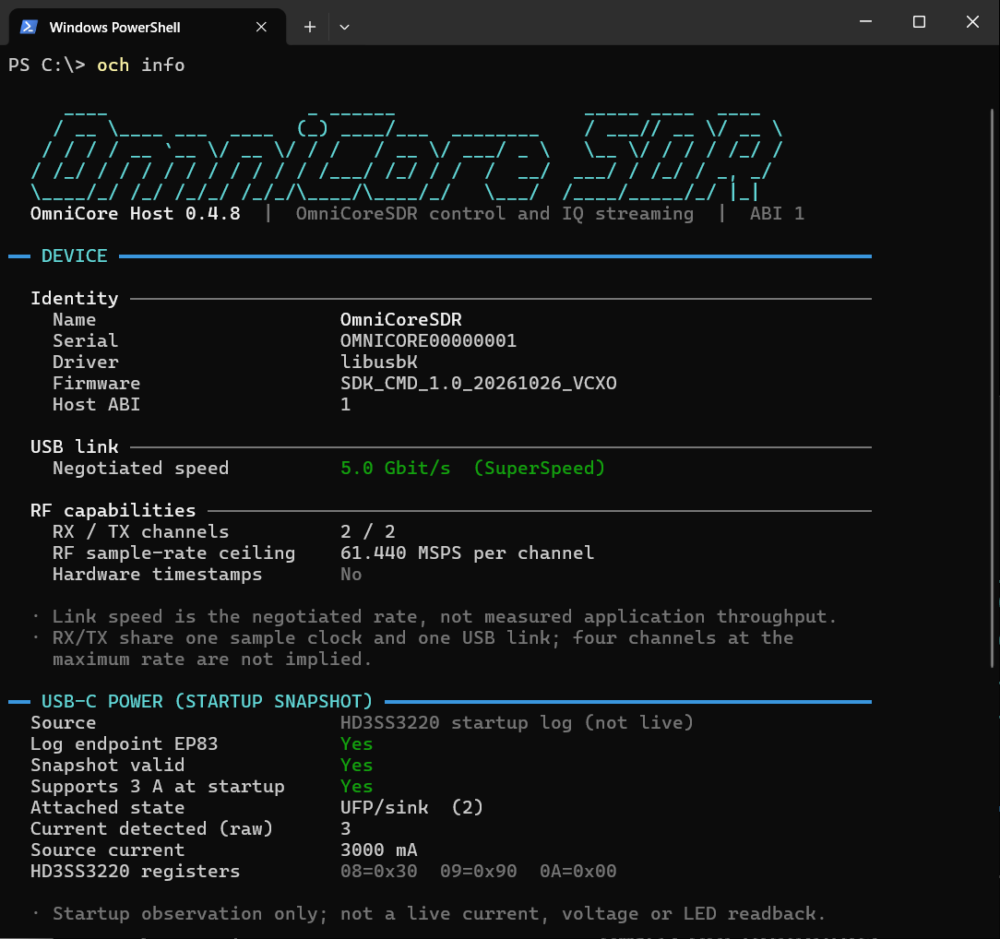
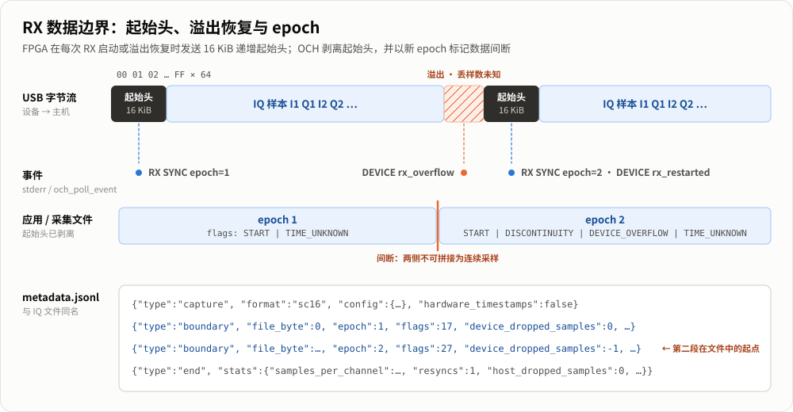
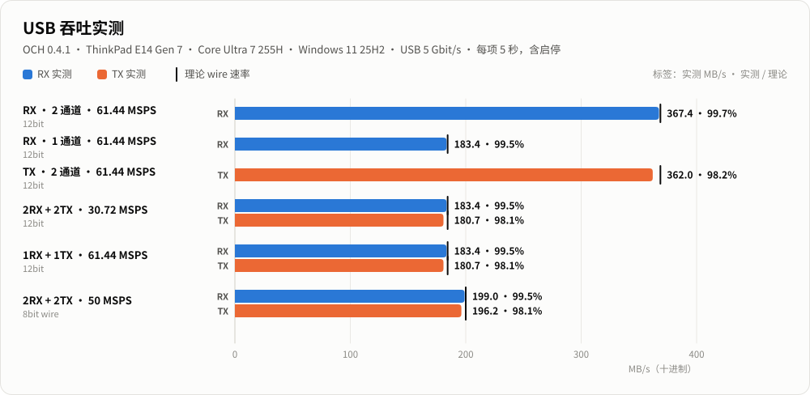
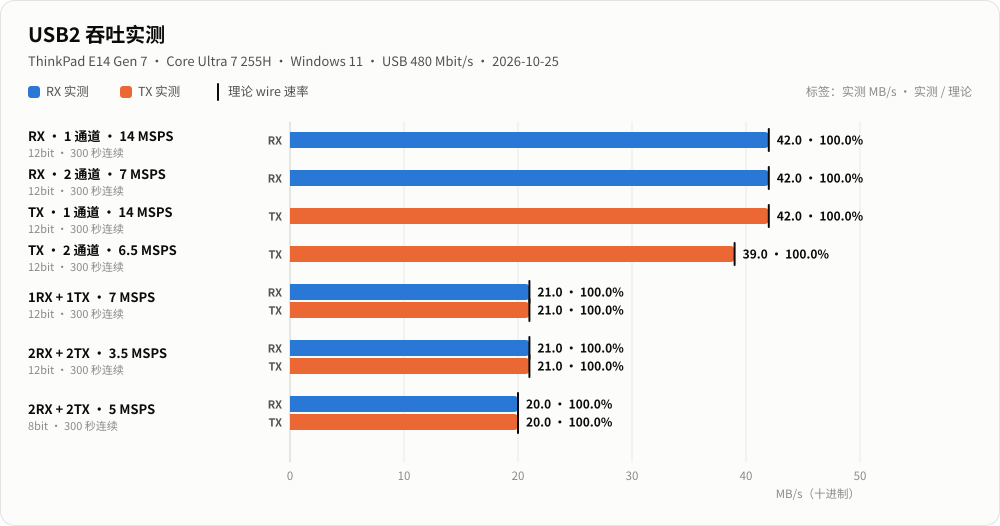
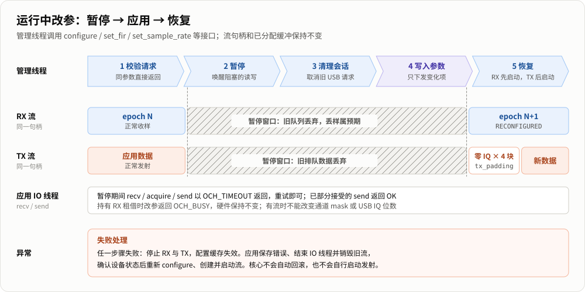

# OmniCore Host (OCH)

OmniCore Host 是 **OmniCoreSDR**（AD9361 + Zynq + CH32H417 USB 桥）的主机端软件：C++17 运行库、命令行工具 `och` 和公共 C/C++ SDK。它负责设备发现、射频控制、连续 IQ 收发、RX 数据边界恢复与吞吐测试，可作为 GNU Radio、MATLAB、SDRangel 等上层软件的接入基础。

| 版本 | 平台 | 接口 | 许可证 |
|---|---|---|---|
| **0.4.3**（C ABI 1） | Windows 10/11 x64（libusbK）<br>Linux x86_64（libusb 1.0） | 纯 C ABI + 仅头文件 C++ RAII 包装 | MIT |



## 目录

1. [功能](#功能)
2. [快速上手](#快速上手)
3. [命令行](#命令行)
4. [性能参考](#性能参考)
5. [C/C++ 开发](#cc-开发)
6. [从源码构建与打包](#从源码构建与打包)
7. [工程目录](#工程目录)
8. [文档索引](#文档索引)

## 功能

| 类别 | 内容 |
|---|---|
| 设备与射频 | 设备发现、状态查询；RX/TX LO、增益、衰减、带宽、通道配置 |
| IQ 数据流 | 单/双通道 RX、TX 与全双工；文件采集与回放、测试正弦、吞吐统计 |
| 数据完整性 | 16 KiB 起始头同步、RX 溢出后自动重同步，以 epoch 和元数据标记间断 |
| USB IQ 格式 | 默认 12bit packed；2TX2RX 可选 8bit signed，降低带宽占用 |
| FIR 与时钟 | AD9361 硬件 FIR 装载与启停、采样率与六级时钟链配置 |
| 运行中改参 | 不销毁流句柄，协调暂停 → 应用配置 → 恢复 |
| 校正与参考 | RX 直流 / IQ 跟踪；ADF4002 内/外 10 MHz 参考；RX/TX 独立外部 LO |
| 监控与板控 | PPS 频偏监控（±1 ppm LOCK）、RGB 状态灯、按温度调速的风扇 |
| USB 链路 | USB 3.0 SuperSpeed；USB 2.0 High-Speed 适用于低采样率 |

## 快速上手

### 1. 安装

**Windows**：运行 `dist/OmniCoreHost-0.4.3-win64-setup.exe`，默认安装到 `C:\Program Files\OmniCore Host` 并加入 PATH。安装包含 `och.exe`、运行库、头文件、MinGW/MSVC 导入库、CMake 包配置、示例与文档，以及驱动助手：

```powershell
och-driver check      # 只检查，不修改系统
och-driver install    # 为 VID 1A86 / PID 5537 安装 libusbK（需 UAC）
```

**Linux**：

```bash
sudo apt-get install build-essential cmake ninja-build pkg-config libusb-1.0-0-dev
bash tools/build-linux.sh
sudo cmake --install build/linux --prefix /opt/omnicore/0.4.3
sudo ln -sfn /opt/omnicore/0.4.3/bin/och /usr/local/bin/och
sudo install -m 0644 packaging/60-omnicore.rules /etc/udev/rules.d/
sudo udevadm control --reload-rules
```

运行无需 sudo；SSH 用户需加入 `plugdev` 组。详见 [Windows 安装](docs/INSTALL_WINDOWS.txt) / [Linux 安装](docs/INSTALL_LINUX.md)。

### 2. 连接设备

```powershell
och version        # 软件版本与 ABI
och find           # 枚举设备
och info           # 身份、固件、USB 链路、射频能力、电源快照
och selftest       # 数字接口自检（RX PRBS / TX 回环）
```

<p align="center"></p>

### 3. 收发 IQ

```powershell
# 双通道接收 5 秒：LO 1 GHz、每通道 15.36 MSPS，保存为 sc16
och rx --file rx.sc16 --format sc16 --channels 1,2 --lo-frequency 1G --sample-rate 15.36M --seconds 5

# 回放上述文件，循环发射 5 秒，TX 衰减 60 dB
och tx --file rx.sc16 --format sc16 --channels 1,2 --lo-frequency 1G --sample-rate 15.36M --loop --seconds 5 --attenuation 60

# 发射 1 MHz 基带测试音
och tx --tone 1M --amplitude 0.25 --channels 1 --lo-frequency 1G --sample-rate 15.36M --seconds 5 --attenuation 60

# 全双工吞吐测试（不读写文件）
och bench --rx --tx --channels 1,2 --sample-rate 30.72M --seconds 10
```

> [!NOTE]
> 发射命令会产生射频输出，请接负载或衰减后的测试回路。`Ctrl+C` 可随时停止；已有采集文件默认不覆盖（需 `--overwrite`）。

### 设备固件要求

安装包只含主机软件，不烧写任何板级固件。设备需 SDK 命令封装 v1 与 CH32 诊断协议 v4；扩展功能按 `och get system.info` 返回的能力字段启用（如 `rx_correction=1`、`external_lo=1`、`pps_monitor=1`），缺少时只拒绝对应功能。详见 [固件兼容性](docs/firmware-compatibility.md)。

## 命令行

### 命令一览

| 类别 | 命令 |
|---|---|
| 设备 | `find` · `info` · `power` · `version` · `selftest` |
| 控制 | `commands` · `get NAME` · `set NAME VALUE` · `action NAME` · `config [RF 选项]` |
| FIR / 时钟 | `fir status` · `fir rx\|tx load FILE` · `fir rx\|tx\|both on\|off` · `clock status` · `clock sample-rate HZ` |
| 数据流 | `rx --file PATH` · `tx --tone HZ` · `tx --file PATH [--loop]` · `bench --rx [--tx]` |

全局选项：`--serial` 选择设备，`--json` 输出机器可读结果，`--no-color` 关闭颜色。数值支持 `k`/`M`/`G` 后缀，规范命令统一使用 Hz 和 dB。

<details>
<summary><b>常用控制示例</b></summary>

```powershell
och set rx.lo-frequency 2.4G
och set tx1.attenuation 10
och config --sample-rate 30.72M --lo-frequency 1G --bandwidth 18M --gain 30

och set rx.dc-correction on          # RX 直流跟踪
och set clock.ref-source external    # 外部 10 MHz 参考（J3）
och set rx.lo-source external        # 外部 LO（RX: J11，TX: J10，输入为 2 倍 RF 频率）
och set pps.input-enabled on         # PPS 监控（J6）
och get pps.status

och fir rx load filter.ftr && och fir rx on
och get core.temperature
och set fan.enabled on
```

全部命令、范围与单位见 `och commands --json` 与 [命令目录](docs/commands.md)。

</details>

### 终端输出

交互终端中按“标题 → 分组 → 字段”分层显示，带颜色、状态标签和实时进度条；重定向到文件时自动切换为纯 ASCII（≤ 78 列），`--json` 则只输出 JSON。

<table>
<tr>
<td width="50%" valign="top"></td>
<td width="50%" valign="top"></td>
</tr>
<tr>
<td align="center"><sub>运行中：会话信息、事件和实时进度</sub></td>
<td align="center"><sub>结束时：吞吐汇总表与分组统计</sub></td>
</tr>
</table>

退出码：`0` 完成 · `1` 设备/传输错误 · `2` 参数错误 · `3` `bench --fail-fast` 提前结束 · `130` Ctrl+C 中断。性能是否达标请检查 JSON 的 `stability.pass`，而非仅看退出码。

### IQ 文件格式

| 格式 | 每通道每样本 | 说明 |
|---|---:|---|
| `packed12` | 3 字节 | USB 原生 12bit |
| `sc16` | 4 字节 | int16 I/Q，小端；`rx`/`tx` 默认 |
| `fc32` | 8 字节 | float32 I/Q，归一化到 ±1 |
| `sc8` | 2 字节 | int8 I/Q，需要 `--iq-bits 8` |

双通道按 `I1,Q1,I2,Q2` 交织，文件无容器头。采集时旁边生成 `.metadata.jsonl`，记录配置、每个 epoch 的起始位置与最终统计——**溢出前后的数据不能当作连续采样拼接**。



完整参数见 [命令行参考](docs/cli.md)。

## 性能参考

理论 wire 速率 = 采样率 × 通道数 × 每样本字节（12bit 为 3，8bit 为 2）。以下为实测平均值，包含流启停开销。

### USB 3.0（5 Gbit/s）



| 配置 | RX / TX MB/s | 理论 MB/s | 错误 |
|---|---:|---:|---:|
| 2RX，61.44 MSPS，12bit | 367.2 / — | 368.6 | 0 |
| 2TX，61.44 MSPS，12bit | — / 362.0 | 368.6 | 0 |
| 2RX + 2TX，30.72 MSPS，12bit | 183.4 / 180.9 | 184.3 | 0 |
| 1RX + 1TX，61.44 MSPS，12bit | 183.8 / 180.7 | 184.3 | 0 |
| 2RX + 2TX，61.44 MSPS，8bit，300 秒 | 245.7 / 245.7 | 245.8 | 0 |

Windows 11 与 Ubuntu 24.04 下 8bit 四通道 61.44 MSPS 均完成 300 秒零错误运行。

### USB 2.0 High-Speed（480 Mbit/s）

USB2 下 RX 与 TX 共享链路预算，需按通道数和精度选择采样率（每项连续 300 秒，1 秒后零新增错误）：



| 配置 | 1 RX | 2 RX | 1 TX | 2 TX | 1RX+1TX | 2RX+2TX | 2RX+2TX 8bit |
|---|---:|---:|---:|---:|---:|---:|---:|
| 稳定采样率（MSPS/通道） | **14** | **7** | **14** | **6.5** | **7** | **3.5** | **5** |

USB2 需要支持 USBHS 的 CH32 固件。测试条件详见 [USB2 稳定传输](docs/usb2.md)；结果与主机和 USB 拓扑有关。

## C/C++ 开发

| 头文件 | 说明 |
|---|---|
| `include/omnicore/och.h` | 纯 C ABI，不跨 DLL 传递 STL / 异常，便于 MSVC、MinGW、C#、Python、MATLAB MEX 调用 |
| `include/omnicore/och.hpp` | 仅头文件的 C++17 RAII 包装 |

```cmake
find_package(OmniCoreHost 0.4 CONFIG REQUIRED)
target_link_libraries(myapp PRIVATE OmniCore::omnicore)
```

```cpp
#include <omnicore/och.hpp>

och::device dev;                         // 唯一设备；多台时传序列号
auto cfg = och::default_config();
cfg.sample_rate = 30720000;
cfg.rx_mask = 3;                         // RX1 + RX2
dev.configure(cfg);

och::stream rx(dev, och::stream_args(OCH_RX));
rx.start();
// rx.recv(...) 或 och::rx_lease 零拷贝读取；元数据中的 epoch / flags 标记数据间断
```

运行中改参由同进程管理线程发起，流句柄保持不变，RX 以新 epoch 标记间断：



示例：[接收](examples/receive.cpp) · [发射](examples/transmit.cpp) · [运行中改参](examples/reconfigure.cpp) · [8bit 全双工](examples/duplex_iq8.cpp)。接口与生命周期详见 [API 参考](docs/api.md)。

## 从源码构建与打包

需要 CMake 3.20+、Ninja 与 C++17 x64 工具链（Windows 使用 MSYS2 MinGW-w64，默认 `C:\msys64\mingw64\bin`）。

```powershell
# Windows：编译并安装到 build/stage
powershell -File tools/build.ps1 -Configuration Release

# 生成安装包 dist/OmniCoreHost-<版本>-win64-setup.exe 及 .sha256
powershell -NoProfile -File packaging/build-package.ps1 -StageDir build/stage
```

```bash
# Linux：编译并安装到 dist/OmniCoreHost-linux
bash tools/build-linux.sh
```

打包脚本会校验 stage 内容与版本号，加入驱动助手、libusbK 与许可证，生成 MSVC 导入库（需 VS Build Tools 的 `lib.exe`），并写入 `PAYLOAD_SHA256.txt`。Inno Setup 6.2.2 已随工程提供，详见 [安装包构建说明](packaging/BUILD_INSTALLER.txt)。

## 工程目录

```text
OmniCoreHost/
├── include/omnicore/   公共 C ABI (och.h) 与 C++ 包装 (och.hpp)
├── src/
│   ├── core/           设备、配置事务、流线程、射频与板控
│   ├── dsp/            IQ 编解码与起始头帧同步
│   ├── transport/      libusbK (Windows) / libusb (Linux) 传输层
│   └── cli/            och 命令行
├── examples/           C++ 示例与 FTR 示例
├── docs/               使用与开发文档、插图
├── cmake/              CMake 包配置模板
├── tools/              构建脚本、驱动助手源码
├── packaging/          安装包脚本、udev 规则
└── third_party/        libusbK / libwdi 及其许可证
```

## 文档索引

| 使用 | 开发 | 专题 |
|---|---|---|
| [命令行参考](docs/cli.md) | [API 参考](docs/api.md) | [FIR 与时钟](docs/fir.md) |
| [命令目录](docs/commands.md) | [架构与性能](docs/architecture.md) | [参考时钟与外部 LO](docs/reference-lo.md) |
| [Windows 安装](docs/INSTALL_WINDOWS.txt) | [设备协议](docs/protocol.md) | [PPS 监控](docs/pps.md) |
| [Linux 安装](docs/INSTALL_LINUX.md) | [固件兼容性](docs/firmware-compatibility.md) | [板级控制](docs/board-control.md) |
| [排错与能力边界](docs/troubleshooting.md) | | [8bit USB IQ](docs/iq8.md) · [USB2](docs/usb2.md) |

## 许可证

本工程源码采用 [MIT 许可证](LICENSE)。libusbK、libwdi 等第三方组件沿用各自许可证，见 `third_party/driver/NOTICES.txt`。
