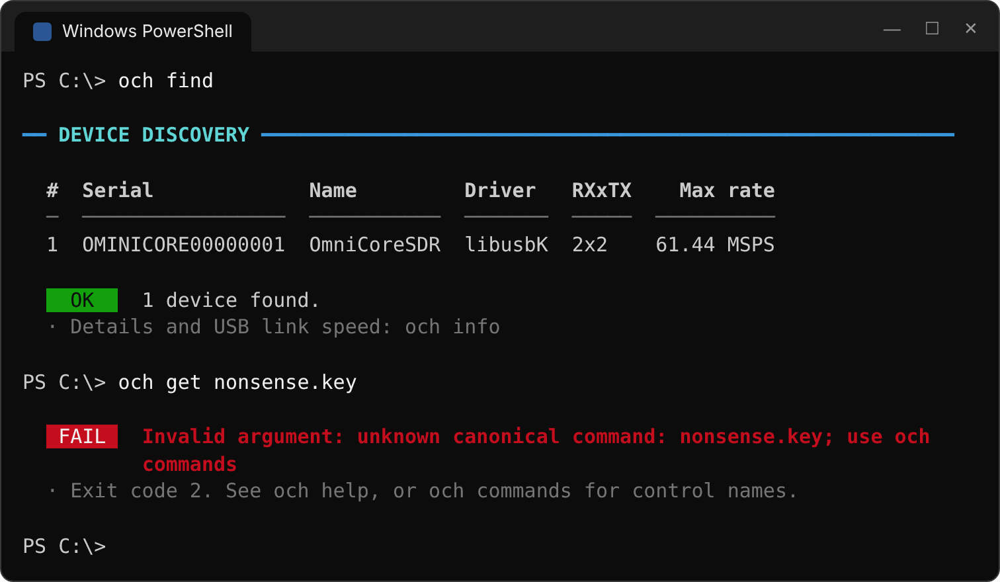

# OmniCore Host (OCH)

OmniCore Host 是 OmniCoreSDR（AD9361 + Zynq + CH32H417 USB 桥）的主机端软件：一个无图形界面的 C++17 运行库，加上命令行工具 `och` 和公共 C/C++ SDK。它负责设备发现、射频控制、连续 IQ 收发、RX 数据边界恢复和吞吐测试，可作为 OnAir、MATLAB、GNU Radio、SDRangel 等上层软件的适配基础。

| 项目 | 说明 |
|---|---|
| 当前版本 | **0.4.3**，C ABI 1 |
| 平台 | Windows 10 / 11 x64，USB 3.x / USB 2.0 High-Speed，libusbK 3.1.0.0 |
| 语言 | C++17 运行库，纯 C ABI + 仅头文件 C++ RAII 包装 |
| 许可证 | MIT（第三方组件沿用各自许可证） |

## 目录

- [功能概览](#功能概览)
- [架构](#架构)
- [系统要求](#系统要求)
- [安装](#安装)
- [快速开始](#快速开始)
- [命令行使用](#命令行使用)
- [C/C++ 开发接口](#cc-开发接口)
- [数据完整性与能力边界](#数据完整性与能力边界)
- [USB 2.0 稳定传输实测](#usb-20-稳定传输实测)
- [从源码构建](#从源码构建)
- [测试](#测试)
- [生成安装包](#生成安装包)
- [测试结果](#测试结果)
- [工程目录](#工程目录)
- [文档索引](#文档索引)

## 功能概览

| 功能 | 说明 | 引入版本 |
|---|---|---|
| 设备与射频控制 | 发现、状态查询、RX/TX LO、增益、衰减、带宽和通道配置 | 0.1 |
| IQ 数据流 | 单/双通道 RX、TX 与全双工；文件采集与播放、测试正弦、吞吐统计、RX 溢出后的起始头重同步 | 0.1 |
| FIR 与采样时钟 | AD9361 硬件 FIR 装载与启停、共享采样率及六级时钟链配置 | 0.2 |
| 运行中改参 | 同进程 API 协调暂停、应用配置并恢复，保留流句柄，以元数据标记间断 | 0.3.0 |
| RX 直流 / IQ 校正 | 独立控制 AD9361 原生 DC 跟踪和 RX 正交跟踪 | 0.3.1 |
| ADF4002 参考与外部 LO | 内部 / 外部 10 MHz 参考选择、D5 通信自检；RX/TX 独立选择外部 LO | 0.3.2 |
| PPS 频率监控 | 测量 DATA_CLK 相对 PPS 的频偏，±1 ppm 内报告 LOCK；不调节时钟 | 0.3.4 |
| RGB 与风扇温控 | RGB 状态灯（默认 15% 亮度）、按 Zynq XADC 温度调速的风扇 | 0.3.5 |
| 8bit USB IQ | 2TX2RX 可选 signed8 传输，降低 USB 带宽占用；默认仍为 12bit | 0.4.0 |
| 分层终端输出 | 彩色分组视图、实时进度条、吞吐汇总表；重定向时自动输出纯 ASCII | 0.4.1 |
| USB 2.0 High-Speed | 支持 480 Mbit/s 连接（需更新 CH32 固件），适合低采样率；仍不支持 Full-Speed | 0.4.2 |
| USB2 实测参考 | 按通道 / 精度记录实测采样率与时长；超出参考值时提示，保留启动恢复与故障统计 | 0.4.3 |

## 架构


- **应用层**：`och` 命令行、上层软件适配器和用户程序都通过同一套公共接口访问设备。
- **公共接口**：`och.h` 是纯 C ABI，`och.hpp` 是仅头文件的 C++ RAII 包装；DLL 边界不暴露 libusbK 句柄、Windows OVERLAPPED 或 FPGA 寄存器。
- **核心运行库**：控制面逐条发送 SDK 命令并分离异步事件；数据面为 RX、TX 各维护独立的 USB 请求队列和有界环形队列，单生产者 / 单消费者。设备对象统一协调配置变更，在不销毁流的前提下暂停、改参和恢复。
- **传输层**：libusbK，控制面与数据面使用不同端点。
- **硬件**：CH32H417 提供 USB 3.0 SuperSpeed（也支持 USB 2.0 High-Speed），Zynq PL 负责 IQ 打包、起始头和 PPS 测频，PS 上的 SDK 负责命令解析和射频驱动，AD9361 完成 2R2T 射频收发。

线程模型、缓冲容量与性能设计见 [架构与性能设计](docs/architecture.md)。

## 系统要求

**主机**

- Windows 10 / 11 x64（不支持 ARM64 或 32 位）
- USB 3.x 主机接口（5 Gbit/s）；也可在 USB 2.0 High-Speed（480 Mbit/s）下使用，但只适合低采样率，需要支持 USBHS 的 CH32 固件，见 [固件与协议依赖](docs/firmware-compatibility.md#usb-20-高速连接)
- 运行 OCH 不需要安装 Visual Studio 或 MinGW

**设备固件**

安装包只包含主机软件，不包含、也不会烧写板级 SDK、ELF、FPGA bitstream 或 CH32 固件。设备需要：

- SDK 命令封装 v1，RX 溢出后重新发送 16 KiB 起始头
- CH32 诊断 / 清理协议 v4
- USB VID `1A86` / PID `5537`，使用 libusbK 驱动（WCH-Link 不属于目标设备）

扩展功能按 `och get system.info` 返回的能力字段启用，而不是按固件名称判断：

| 功能 | 所需能力字段 |
|---|---|
| RX 校正 | `rx_correction=1` |
| ADF4002 状态 / 自检 | `adf4002=1`；参考选源另需 `ref_source=1` |
| 外部 LO | `external_lo=1` |
| PPS 监控 | `pps_monitor=1`，以及带 PPS 的比特流 |
| RGB / 风扇 / 核心温度 | `board_rgb=1 fan_control=1 core_temp=1` |
| 8bit USB IQ | 支持 `iq_format` 的 SDK 和 FPGA IP 1.1 / revision 10 |

缺少某项能力时，只拒绝对应的扩展功能，其余功能照常工作。详见 [固件与协议依赖](docs/firmware-compatibility.md)。

## 安装

运行 `dist/OmniCoreHost-0.4.3-win64-setup.exe`，默认安装到 `C:\Program Files\OmniCore Host`，并将 `bin` 加入 PATH。安装包包含：

- `och.exe`、`omnicore.dll`、`libusbK.dll`
- C/C++ 头文件、MinGW 与 MSVC 导入库、CMake 包配置
- 示例代码、使用文档、第三方许可证
- 离线驱动助手 `och-driver.exe`

驱动安装会正常请求 UAC，只匹配 VID 1A86 / PID 5537 的设备，已使用 libusbK 时跳过替换。安装时未连接设备也可以完成，之后再运行：

```powershell
och-driver check      # 只检查，不修改系统
och-driver install    # 安装 libusbK
```

应用安装包目前没有发布者代码签名；驱动安装仍须满足 Windows 的签名与安全策略。详见 [Windows 安装说明](docs/INSTALL_WINDOWS.txt)。

## 快速开始

安装后打开新的终端：

```powershell
och version                 # 软件版本与 ABI
och find                    # 枚举设备
och info                    # 身份、固件、USB 链路、射频能力、电源快照
och get system.status       # 完整设备状态
och commands                # 全部规范控制命令
och help                    # 命令与参数说明
```

<p align="center"></p>

USB3 连接下，做一次 10 秒全双工吞吐测试：

```powershell
och bench --rx --tx --sample-rate 30.72M --channels 1,2 --seconds 10
```

结束时输出吞吐汇总表，随后是 RX、TX 各自的分组统计（下例为 12 秒运行，重定向输出时的纯文本形式）：

```text
== STREAM COMPLETE ===========================================================
  Stop reason                 Requested duration reached
  Events received             4

  Dir  Ch  MSPS/ch  Time s  USB MB/s  Wire MB/s   Ratio  Faults
  ---  --  -------  ------  --------  ---------  ------  ------
  RX    2    30.72   12.20     183.9      184.3  99.8 %       2
  TX    2    30.72   12.14     182.9      184.3  99.2 %       1
```

`Ratio` 是实测 USB 吞吐与理论 wire 速率之比，平均值包含流启动和停止时间。`Faults` 保留溢出、欠流、重同步、主机损失、传输错误与 TX 补零的原始计数；设备计数在 RX/TX 间共享，不应相加作为设备事件总数。稳定性判定允许**前 1 秒内观察到并完成恢复的 RX 溢出及对应重同步**，以 `Startup RX recoveries` 单列，1 秒之后必须没有新增错误；仅看上述总计表无法判断事件发生时间。USB2 请按下方[稳定传输实测](#usb-20-稳定传输实测)选取采样率，不能直接使用 USB3 的示例速率。

## 命令行使用

### 命令一览

| 类别 | 命令 |
|---|---|
| 设备 | `find`、`info`、`power [status]`、`version` |
| 控制 | `commands`、`get NAME`、`set NAME VALUE`、`action NAME`、`config [RF 选项]`、`selftest` |
| FIR 与时钟 | `fir status`、`fir rx\|tx\|both on\|off`、`fir rx\|tx load FILE`、`clock status`、`clock sample-rate HZ`、`clock set --rx-chain CSV --tx-chain CSV` |
| 数据流 | `rx --file PATH`、`tx --tone HZ`、`tx --file PATH [--loop]`、`bench --rx [--tx]` |

全局选项：`--serial SERIAL` 选择设备，`--json` 输出机器可读结果，`--no-color` 关闭颜色。完整参数见 [命令行参考](docs/cli.md) 和 `och help`。

### 终端输出

默认输出面向阅读：每个命令按“标题 → 分组 → 字段”分层显示，状态用 `OK` / `INFO` / `WARN` / `FAIL` 标记，非零故障计数高亮，说明性备注以灰色显示在末尾。流命令在终端中每秒刷新一行进度条和实时 MB/s。

| 场景 | 输出形式 |
|---|---|
| 交互式终端（Windows Terminal、支持 VT 的控制台） | 彩色、Unicode 分隔线、实时进度条 |
| `--no-color` 或设置了 `NO_COLOR` 环境变量 | 保留 Unicode 布局，不输出颜色 |
| 输出重定向到文件或管道 | 纯 7-bit ASCII，每行不超过 78 列，无进度刷新 |
| `--json` | stdout 为 JSON 结果，stderr 为事件 / 错误 JSON 行，不含任何装饰 |

<table>
<tr>
<td width="50%" valign="top"></td>
<td width="50%" valign="top"></td>
</tr>
<tr>
<td align="center"><sub><code>och bench</code> 运行中：会话信息、事件和实时进度</sub></td>
<td align="center"><sub>结束时：吞吐汇总表和分组统计</sub></td>
</tr>
</table>

<details>
<summary>更多终端输出：设备状态、设备发现与错误提示</summary>
<br>
<p align="center"></p>
<p align="center"></p>
</details>

文本布局可能随版本改进；脚本和自动化应使用 `--json` 或 C/C++ API。退出码：`0` 命令完成，`1` 设备 / 传输 / 运行错误，`2` 参数错误，`3` 为 `bench --fail-fast` 因连续溢出提前结束，`130` 被 Ctrl+C 中断并已清理。

### IQ 采集与播放

```powershell
# 双通道采集 2 秒，sc16 格式，同时生成 capture.sc16.metadata.jsonl
och rx --sample-rate 30.72M --channels 1,2 --seconds 2 --file capture.sc16 --format sc16

# 播放采集文件到结尾；--loop 循环播放
och tx --sample-rate 30.72M --channels 1,2 --file capture.sc16 --format sc16
och tx --sample-rate 30.72M --channels 1,2 --file capture.sc16 --loop --seconds 30

# 发射 1 MHz 复正弦
och tx --sample-rate 30.72M --channels 1 --tone 1M --amplitude 0.25 --attenuation 10 --seconds 10
```

| 格式 | 每通道每样本 | 说明 |
|---|---:|---|
| `packed12` | 3 字节 | USB 原生 12bit 格式 |
| `sc16` | 4 字节 | int16 I/Q，12bit 左对齐，小端；`rx`/`tx` 默认 |
| `fc32` | 8 字节 | float32 I/Q，归一化到 ±1 |
| `sc8` | 2 字节 | int8 I/Q，需要 `--iq-bits 8` |


- 双通道文件按 `I1,Q1,I2,Q2` 交织；单通道为所选物理通道的 `I,Q`。文件没有额外容器头。
- 采集会剥离完整的 16 KiB 起始头。旁边的 `.metadata.jsonl` 依次记录 `capture`（格式与配置）、`boundary`（每个新 epoch 在文件中的字节 / 样本位置及丢样信息）和 `end`（最终统计）。
- 已存在的采集文件默认不会被覆盖，需显式传 `--overwrite`。


- `--seconds 0` 持续运行直到 Ctrl+C；文件播放默认运行到文件结尾。
- 无 `--loop` 的播放文件至少需要四个 USB 块（12bit 双通道约 13 万样本）用于预填充。
- 有限文件播放到结尾后，设备仍在消耗 FIFO，此时可能报告尾部欠流；这与持续流中途欠流需分开判断。USB 传输完成也不等于 DAC 已经播放完毕。

### 吞吐测试

`bench` 不读写文件，使用原生 wire 格式（12bit 为 packed12，`--iq-bits 8` 为 sc8），用于衡量 USB 链路与主机处理能力：

```powershell
och bench --rx --sample-rate 61.44M --channels 1,2 --seconds 30          # 双 RX 满速率
och bench --tx --sample-rate 61.44M --channels 1,2 --seconds 30          # 双 TX 满速率（发射测试正弦）
och bench --rx --tx --sample-rate 30.72M --channels 1,2 --seconds 30     # 2RX + 2TX
och bench --rx --tx --sample-rate 61.44M --channels 1 --seconds 30       # 1RX + 1TX 满速率
och bench --rx --tx --iq-bits 8 --sample-rate 61.44M --channels 1,2 --seconds 30   # 8bit 2RX + 2TX 满速率
```

以上为 USB3 示例。理论 wire 速率 = 采样率 × 通道数 × 每样本字节（12bit 为 3，8bit 为 2），MB/s 为十进制；USB2 的 RX 与 TX 共用链路预算，需计算双向合计值。实测结果见 [USB2 实测](#usb-20-稳定传输实测)与 [USB3 验证状态](#验证状态)。默认每方向 64 MiB 主机环形缓冲、32 个并行 USB 请求、每请求 196608 字节，可用 `--buffer-mib`、`--queue`、`--block` 调整；增大缓冲只能吸收短时调度停顿，不能弥补长期处理能力不足。

### 射频控制

规范命令统一使用 Hz 和 dB，数值支持 `k`/`M`/`G` 后缀：

```powershell
och set rx.lo-frequency 2.4G
och set tx1.attenuation 10
och get rx.lo-frequency
och config --sample-rate 30.72M --lo-frequency 1G --bandwidth 18M --gain 30   # 一次应用多项，不启动 TX
```

每个流命令都会按命令行参数和默认配置重新配置射频；需要特定 LO、带宽、增益时随流命令一起传入。原 SDK 命令名仍作为原始透传保留并沿用其原单位（例如 `och set rx_lo_freq 1000` 中的 1000 是 MHz），请勿混用两套单位。全部命令、范围和单位见 `och commands --json` 与 [命令目录](docs/commands.md)。

### FIR 与时钟

```powershell
och fir status
och fir rx load filter.ftr      # 先完整校验文件，再分块上传、校验；装载后该方向 FIR 保持关闭
och fir rx on
och clock status
och clock sample-rate 30.72M
```

FTR 文件若含时钟 / 带宽配置，必须显式处理，或用 `--coefficients-only` 忽略。已装载的 FIR 在后续流配置中保留；改变采样率后需重新确认滤波器频响。详见 [FIR 与时钟](docs/fir.md)。

### RX 校正、参考时钟与外部 LO

| 功能 | 查询 | 设置 / 操作 |
|---|---|---|
| RX 直流跟踪 | `och get rx.dc-correction` | `och set rx.dc-correction on\|off` |
| RX IQ 跟踪 | `och get rx.iq-correction` | `och set rx.iq-correction on\|off` |
| 参考源 | `och get clock.ref-source` | `och set clock.ref-source internal\|external` |
| ADF4002 状态 | `och get clock.ref-status` | — |
| D5 通信自检 | — | `och action clock.ref-test` |
| RX / TX LO 源 | `och get rx.lo-source` / `tx.lo-source` | `och set rx.lo-source internal\|external` |

- 校正开关接受 `on/off`、`true/false`、`1/0`。DC 同时控制 RF 与基带直流跟踪；关闭只停止连续跟踪，已有系数仍生效；不执行 TX IQ 校准。
- 未接外部 10 MHz 时保持内部参考，可用 `clock.ref-test` 检查 ADF4002 控制通信：D5 亮 0.5 秒、灭 0.5 秒，重复三次，结束后恢复原参考选择。
- 外部参考接 **J3**。它驯服板载 40 MHz 振荡器，**AD9361 的参考频率仍为 40 MHz**。ADF4002 的 MUXOUT 只接 D5，软件无法读回锁定状态，锁定与否以 D5 常亮为准。
- 外部 LO：RX 接 **J11**，TX 接 **J10**。物理输入频率为名义 RF 频率的 **2 倍**，外部模式支持名义 RF 70 MHz–4 GHz；`rx.lo-frequency` / `tx.lo-frequency` 此时只声明频率，不能调节信号源。切回内部恢复该方向最后一次内部 PLL 频率。
- 这些 CLI 命令要求设备未被其他进程占用。已有应用正在收发时，应通过该应用内的 C/C++ API 改参。


详见 [参考时钟与外部 LO](docs/reference-lo.md)。

### PPS 频率监控

```powershell
och set pps.input-enabled on
och get pps.status --json
och set pps.input-enabled off
```

PPS 接 **J6**（PPS_EXT）。监控测量 DATA_CLK（2R2T LVDS 下为采样率的 4 倍，30.72 MSPS 时为 122.88 MHz）相对 PPS 的频率，只测量不调节。开启后需要两个连续脉冲；无输入时先显示 `waiting`，1.5 秒后变为 `no_signal`。监控有效且频偏绝对值 ≤ 1 ppm 时 `locked=1`。PPS 的 LOCK 不代表 ADF4002 锁相，也不提供 IQ 时间戳或定时发射。开关监控不需要停流。详见 [PPS 监控](docs/pps.md)。

### RGB、风扇与温度

```powershell
och get core.temperature        # Zynq 核心温度（AD9361 温度在 system.status 中单独列出）
och get rgb.status
och set rgb.enabled on
och get fan.status
och set fan.enabled on
```

RGB 默认开启、15% 亮度（兼容旧版 25% 固件，以设备回报为准）；风扇温控默认关闭，开启后 25 kHz PWM 按温度调速。开关与查询不暂停 IQ 流。详见 [板级控制](docs/board-control.md)。

### USB-C 电源信息

`och power` 与 `och info` 读取 HD3SS3220 的**启动日志**（EP83），报告启动时的连接角色和 3 A 能力公告。它不是实时电流或电压测量，也不是 LED 读回。读取会消费日志字节，缓存只在当前进程内保留，因此第一次 `info` 显示支持 3 A、之后另一次 `power` 显示 unknown 是正常现象。详见 [命令行参考](docs/cli.md#usb-c-电源信息)。

## C/C++ 开发接口

- `include/omnicore/och.h`：纯 C ABI。DLL 边界不传递 STL、C++ 异常或跨运行库分配的对象，便于 MSVC、MinGW、C#、Python、MATLAB MEX 等调用。
- `include/omnicore/och.hpp`：仅头文件的 C++17 RAII 包装。

```cmake
find_package(OmniCoreHost 0.4 CONFIG REQUIRED)
target_link_libraries(myapp PRIVATE OmniCore::omnicore)
```

```cpp
#include <omnicore/och.hpp>

och::device dev;                         // 唯一设备；多台时传序列号
auto cfg = och::default_config();
cfg.sample_rate = 30720000;
cfg.rx_mask = 3;                         // RX1 + RX2
cfg.tx_mask = 0;
dev.configure(cfg);

och::stream rx(dev, och::stream_args(OCH_RX));
rx.start();
// rx.recv(...) / och::rx_lease 零拷贝读取，元数据中的 epoch 与 flags 标记数据间断
```

要点：

- 对象的创建与销毁必须配对使用本 SDK 的函数。插件层应依赖公开 API，不直接操作 libusbK 管道或 SDK 串口。
- 运行中改参由同进程管理线程发起；收发线程遇到 `OCH_TIMEOUT` 时重试。持有 RX 租借时不得改参。RX 重配后以 `RECONFIGURED` 和新 epoch 标记间断；活动 TX 丢弃旧队列并以零 IQ 预填恢复。失败会停止双方并使配置缓存失效。
- 校正、参考源、LO 源、PPS、板控通过独立 getter/setter 访问，不扩展 `och_config`，ABI 1 的结构大小保持不变。


示例：[接收](examples/receive.cpp)、[发射](examples/transmit.cpp)、[运行中改参](examples/reconfigure.cpp)、[8bit 全双工](examples/duplex_iq8.cpp)。接口、格式与生命周期详见 [API 参考](docs/api.md)。

## 数据完整性与能力边界

- RX 自动剥离完整的 16 KiB 递增起始头，重同步后开始新的 epoch。`.metadata.jsonl` 和流元数据用于说明数据间断，**不能把溢出前后的数据当作连续采样拼接**。
- 设备目前无法提供精确丢样数、硬件时间戳、PPS 对齐的采样时间或定时发射。
- 运行中实际切换参数会停流、清理旧队列并丢样；参数未改变时不重启流。
- CLI 以独占方式打开设备，第二个 `och.exe` 不能控制其他进程持有的流。
- 尚未用独立仪表测量：参考的绝对频率精度、VCXO 调谐范围、外部 LO 射频性能、DC 残留与镜像抑制。通信自检和数字自检不能替代这些测量。

更多排错信息见 [排错与能力边界](docs/troubleshooting.md)。

## USB 2.0 稳定传输实测

| 测试条件 | |
|---|---|
| 主机 | Lenovo ThinkPad E14 Gen 7，Intel Core Ultra 7 255H，32 GB RAM |
| 系统 | Windows 11，build 26200 |
| USB | High-Speed，480 Mbit/s，libusbK 3.1.0.0 |
| 板卡 | OmniCoreSDR，固件 `SDK_CMD_1.0_20261024_IQ8` |
| 参数 | 0.5 MSPS 步进，每项 300 秒；TX 为 1 MHz 正弦、幅度 0.25、衰减 60 dB |

七种配置均通过连续 300 秒测试。允许前 1 秒内完成的 RX 启动恢复，之后零新增错误；各方向平均 USB 吞吐达到理论 wire 速率的 98% 以上。


| 配置 | USB IQ | 稳定采样率 MSPS/通道 | RX / TX MB/s | 启动恢复 | 1 秒后新增错误 |
|---|---:|---:|---:|---:|---:|
| 1 RX | 12bit | **14** | 41.998 / — | 2 | 0 |
| 2 RX | 12bit | **7** | 41.998 / — | 0 | 0 |
| 1 TX | 12bit | **14** | — / 41.987 | 0 | 0 |
| 2 TX | 12bit | **6.5** | — / 38.988 | 0 | 0 |
| 1 RX + 1 TX | 12bit | **7** | 20.999 / 20.993 | 1 | 0 |
| 2 RX + 2 TX | 12bit | **3.5** | 20.999 / 20.993 | 0 | 0 |
| 2 RX + 2 TX | 8bit | **5** | 19.999 / 19.994 | 1 | 0 |

采样率均为**每通道**；单通道使用 CH1，双通道使用 CH1 + CH2。表中为本机测试结果，`bench` 使用原生 packed12 / signed8，不包含磁盘写入和应用格式转换。`61.44 MSPS` 是 RF 采样率上限，USB2 持续传输采样率参考上表。

```powershell
# 12bit 双通道全双工
och bench --rx --tx --channels 1,2 --sample-rate 3.5M --seconds 300 --attenuation 60 --fail-fast

# 8bit 双通道全双工
och bench --rx --tx --channels 1,2 --iq-bits 8 --sample-rate 5M --seconds 300 --attenuation 60 --fail-fast
```

<details>
<summary>USB2 设备信息与吞吐测试输出</summary>
<br>

<br>

</details>

`--fail-fast` 在启动窗口之后遇到连续 RX 溢出时提前停流并保留统计。测试条件、判定方式及各项通过记录见 [USB2 测试结果](docs/usb2.md)。

## 从源码构建

需要 CMake 3.20+、Ninja 和支持 C++17 的 x64 工具链。Windows 版本使用 MSYS2 MinGW-w64（默认路径 `C:\msys64\mingw64\bin`）：

```powershell
powershell -File tools/build.ps1 -Configuration Release
.\build\och.exe version
```

脚本配置并编译主机程序，然后安装到 `build/stage`。构建不访问设备，也不编译或烧写板级固件。

## 测试

| 测试 | 位置 | 内容 | 需要硬件 |
|---|---|---|---|
| CLI 离线测试 | `tests/cli_tests.cpp` | 参数与数值解析、FTR 文件校验、终端输出布局（ASCII / 78 列 / 颜色序列配对）、统计判定 | 否 |
| 运行时回归 | `tests/runtime_tests.cpp` | 生产 C API、配置事务、流线程和编解码，对接进程内模拟 USB 传输 | 否 |
| CLI 实板测试 | `tests/hardware/cli_hardware_tests.ps1` | 端到端运行 `och.exe`：基础查询、控制回读、参数校验、文件采集与播放、吞吐测试、输出格式 | 是 |
| USB2 采样率实测 | `tests/hardware/usb2_characterize.py` | 串行扫描配置，检查吞吐和全部故障计数，保存原始 JSON、事件与二进制哈希 | 是 |
| 运行中改参实测 | `tools/run-hardware-reconfigure.ps1` | 持续流中反复改参的恢复行为 | 是 |

```powershell
# 离线测试
cmake -S tests -B build/runtime-tests -G Ninja
cmake --build build/runtime-tests
ctest --test-dir build/runtime-tests --output-on-failure

# USB3 实板测试（TX 用例默认 60 dB 衰减；请接负载或天线）
powershell -ExecutionPolicy Bypass -File tests/hardware/cli_hardware_tests.ps1
powershell -File tests/hardware/cli_hardware_tests.ps1 -Group capture,bench -BenchSeconds 30
```


<details>
<summary>CLI 实板测试的完整输出</summary>
<br>

</details>

用例清单、参数和判定规则见 [tests/README.md](tests/README.md)。

## 生成安装包

```powershell
powershell -File tools/build.ps1 -Configuration Release
powershell -NoProfile -File packaging/build-package.ps1 -StageDir build/stage
```

输出 `dist/OmniCoreHost-<版本>-win64-setup.exe` 及 `.sha256`。打包脚本会校验 stage 目录内容与版本号，加入驱动助手、libusbK、许可证与源码包，生成 MSVC 导入库，检查未打包的编译器运行库依赖，并为全部负载写入 `PAYLOAD_SHA256.txt`。需要 Visual Studio C++ Build Tools 中的 `lib.exe`；Inno Setup 6.2.2 已随工程提供。详见 [安装包构建说明](packaging/BUILD_INSTALLER.txt)。

## 测试结果

**0.4.3**（2026-10-25）

- 7 种通道 / 精度配置均完成 **300 秒**验收，按 **0.5 MSPS** 步进确定本机参考值；见上方[实测表](#usb-20-稳定传输实测)与[完整报告](docs/usb2.md)。
- 允许前 1 秒内完成的 RX 启动恢复，之后零新增错误；启动计数完整保留。
- 离线回归：**23 / 23 CLI、91 / 91 运行时、5 / 5 USB2 判定测试通过**。
- 最终程序已复核 USB2 `info` 文本 / JSON、7 项参考值、参数检查及 30 秒全双工输出；重定向布局保持纯 ASCII、最多 78 列。

**0.4.2**（2026-10-25）

| 测试条件 | |
|---|---|
| 主机 | Lenovo ThinkPad E14 Gen 7，Intel Core Ultra 7 255H，32 GB DDR5-5600，外接电源 |
| 系统 | Windows 11 家庭版 25H2（build 26200.9711） |
| USB | Intel USB 3.20 xHCI 控制器，链路 5 Gbit/s，libusbK 3.1.0.0 |
| 板卡 | OmniCoreSDR，固件 `SDK_CMD_1.0_20261024_IQ8`（JTAG 加载） |
| 参数 | bench 每项 5 秒（8bit 61.44 MSPS 另测 10 / 60 / 300 秒），TX 衰减 60 dB，采集写入 NVMe SSD |

- 离线：CLI 测试 20/20，运行时回归 91/91。
- CLI 实板测试 42 项，无失败。吞吐结果（每项 5 秒，平均值包含启停）：


| 配置 | 方向 | 实测 MB/s | 理论 MB/s | 比例 | 主机丢样 / 传输错误 |
|---|---|---:|---:|---:|---|
| 2 通道 61.44 MSPS，12bit | RX | 367.2 | 368.6 | 99.6% | 0 / 0 |
| 1 通道 61.44 MSPS，12bit | RX | 183.6 | 184.3 | 99.6% | 0 / 0 |
| 2 通道 61.44 MSPS，12bit | TX | 362.0 | 368.6 | 98.2% | 0 / 0 |
| 2RX + 2TX 30.72 MSPS，12bit | RX / TX | 183.4 / 180.9 | 184.3 | 99.5% / 98.1% | 0 / 0 |
| 1RX + 1TX 61.44 MSPS，12bit | RX / TX | 183.8 / 180.7 | 184.3 | 99.7% / 98.1% | 0 / 0 |
| 2RX + 2TX 50 MSPS，8bit | RX / TX | 199.2 / 196.3 | 200.0 | 99.6% / 98.1% | 0 / 0 |
| 2RX + 2TX 61.44 MSPS，8bit，300 秒 | RX / TX | 245.7 / 245.7 | 245.8 | 100.0% / 100.0% | 0 / 0 |

**8bit 2RX + 2TX @ 61.44 MSPS**

| 时长 | RX MB/s | TX MB/s | 每通道样本（RX） | 溢出 / 欠流 / 重同步 | 主机丢样 / 传输错误 |
|---|---:|---:|---:|---|---|
| 10 秒 | 245.2 | 243.5 | 6.23 亿 | 0 / 0 / 0 | 0 / 0 |
| 60 秒 | 245.7 | 245.4 | 36.9 亿 | 0 / 0 / 0 | 0 / 0 |
| 300 秒 | 245.7 | 245.7 | 184.4 亿 | 0 / 0 / 0 | 0 / 0 |
| 60 秒（0.4.2 正式构建） | 245.7 | 245.4 | 37.0 亿 | 0 / 0 / 0 | 0 / 0 |


**0.4.0 长时间测试**

- 8bit 2RX + 2TX 在 **50 MSPS 下连续 300 秒无新增错误**，RX/TX 各约 200 MB/s。
- 12bit 2RX + 2TX 44.25 MSPS 连续 60 秒无错；9 项通道 / 格式矩阵通过。详见 [8bit 扩展验证](docs/iq8.md#实板验证2026-10-24)。

**功能测试**

| 项目 | 结果 | 记录 |
|---|---|---|
| PPS 监控 | 真实 PPS 输入下 30.72 MSPS 稳定读数 122880000–122880001 Hz，频偏收敛至 0–0.008 ppm（相对输入 PPS） | [pps.md](docs/pps.md) |
| 参考与外部 LO | 参考 / LO 11 项检查与 3 次运行中切换；ADF4002 GPIO 检查通过，D5 闪烁序列经人工观察确认 | [reference-lo-validation.md](docs/reference-lo-validation.md) |
| RX 校正 | 18 项检查与 6 次运行中切换通过 | [rx-correction-validation.md](docs/rx-correction-validation.md) |
| 运行中改参 | RX、TX 与双向的实机改参恢复 | [runtime-reconfiguration-validation.md](docs/runtime-reconfiguration-validation.md) |
| 数字接口 | RX PRBS 与 TX 数字回环通过 | — |

实机验证中的板级固件通过 JTAG 加载到 RAM，未写入启动 Flash；板级 ELF / BOOT 与主机安装包分开交付。

## 工程目录

```text
OmniCoreHost/
├── include/omnicore/    公共 C ABI (och.h) 与 C++ 包装 (och.hpp)
├── src/
│   ├── core/            设备、配置事务、流线程、射频与板控
│   ├── dsp/             IQ 编解码与起始头帧同步
│   ├── transport/       libusbK 传输层
│   └── cli/             och 命令行：参数、命令目录、终端视图
├── tests/               离线测试、模拟 USB 设备、实板测试脚本
├── examples/            C++ 示例与 FTR 示例
├── docs/                使用、开发与验证文档
│   └── images/          文档插图及其生成脚本
├── cmake/               CMake 包配置模板
├── tools/               构建脚本、驱动助手源码、运行中改参实测程序
├── packaging/           Inno Setup 脚本与打包脚本
├── third_party/         libusbK / libwdi 及其许可证和来源
├── build/               编译产物（build/stage 为安装暂存目录）
└── dist/                安装包与 SHA256 校验文件
```

板级 SDK 工程位于同级目录 `AD9361_Template_1/AD9361_Template.sdk`，不属于主机安装内容。

## 文档索引

| 文档 | 内容 |
|---|---|
| [命令行参考](docs/cli.md) | 全部 CLI 命令、参数、输出与退出码 |
| [命令目录](docs/commands.md) | 规范控制命令、单位、范围及 SDK 对照 |
| [API 参考](docs/api.md) | C/C++ 接口、数据格式与对象生命周期 |
| [架构与性能](docs/architecture.md) | 分层设计、线程与缓冲模型 |
| [设备协议](docs/protocol.md) | 控制封装与数据协议 |
| [FIR 与时钟](docs/fir.md) | FTR 格式、装载事务与时钟限制 |
| [参考时钟与外部 LO](docs/reference-lo.md) | ADF4002、外部 10 MHz 与外部 LO |
| [PPS 监控](docs/pps.md) | PPS 频率监控原理与验证 |
| [板级控制](docs/board-control.md) | RGB、风扇温控与核心温度 |
| [USB2 稳定传输](docs/usb2.md) | 0.5 MSPS 步进、300 秒长测、启动恢复与通过记录 |
| [8bit USB IQ](docs/iq8.md) | signed8 传输格式、API 与验证 |
| [固件兼容性](docs/firmware-compatibility.md) | 固件与协议依赖 |
| [排错](docs/troubleshooting.md) | 常见问题与能力边界 |
| [Windows 安装](docs/INSTALL_WINDOWS.txt) | 安装、驱动与卸载 |
| [测试说明](tests/README.md) | 离线与实板测试 |

## 许可证

本工程源码采用 [MIT 许可证](LICENSE)。libusbK、libwdi 等第三方组件沿用各自的许可证与声明，见 `third_party/driver/NOTICES.txt`。
