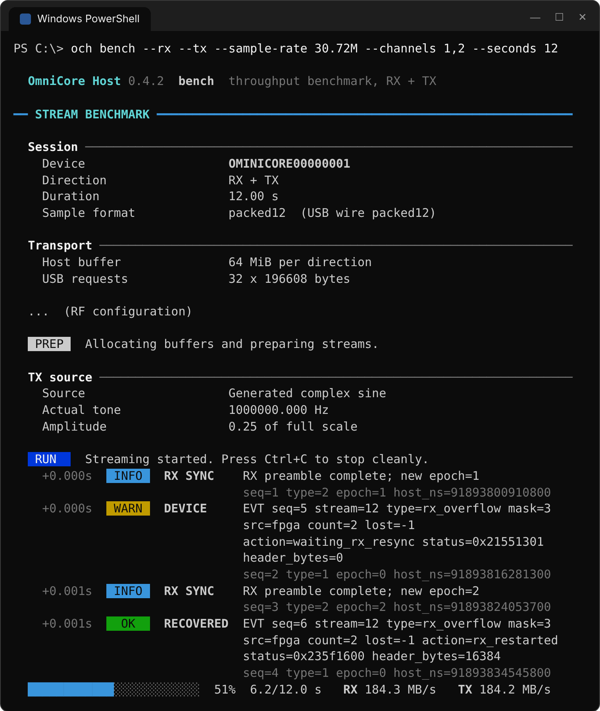
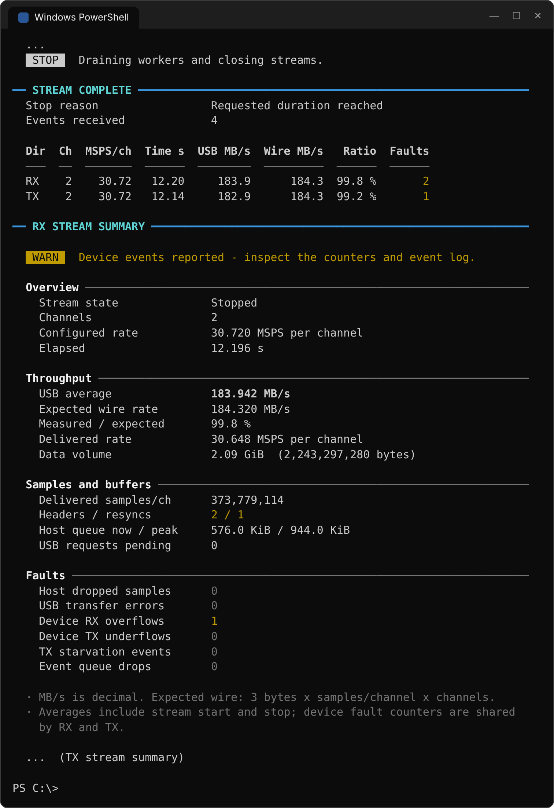
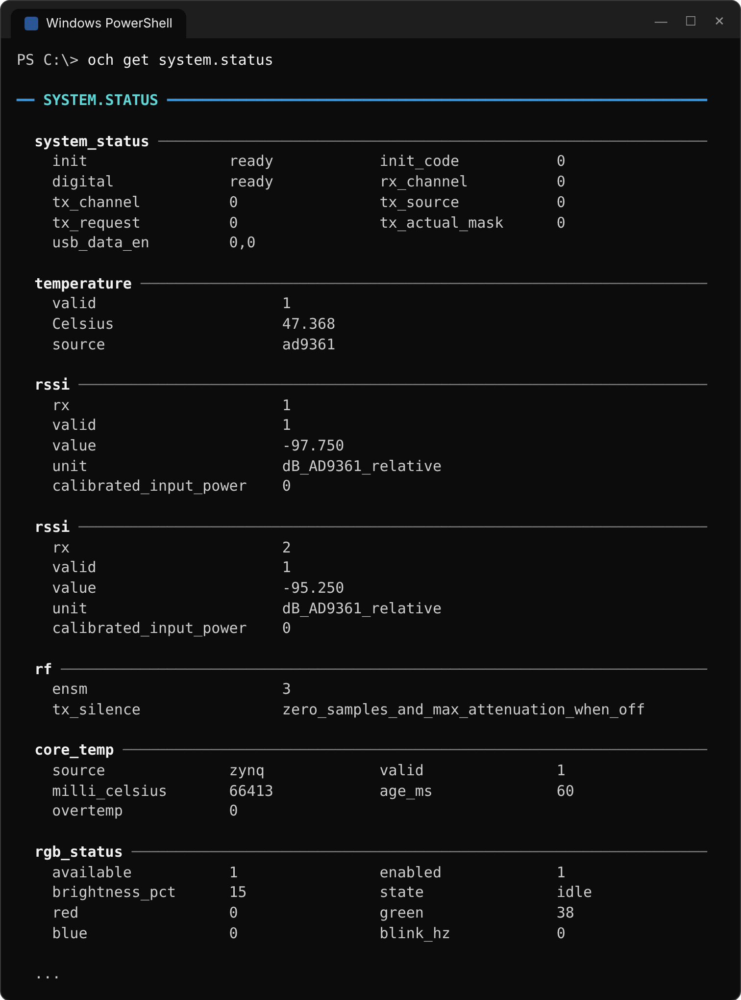

# 命令行参考

统一入口为 `och`。全局选项：

| 选项 | 含义 |
|---|---|
| `--serial SERIAL` | 指定设备；未指定时只允许唯一匹配设备 |
| `--json` | stdout 输出 JSON 结果，stderr 输出事件 / 错误 JSON 行 |
| `--no-color` | 关闭颜色；也可设置环境变量 `NO_COLOR` |
| `--help` | 显示帮助 |

## 终端输出与脚本

默认输出供人阅读，按三层组织：

1. **标题**：每个功能区一条整行标题，例如 `DEVICE`、`RF CONFIGURATION`、`RX STREAM SUMMARY`。
2. **分组**：标题下的小节，例如 `Identity`、`Throughput`、`Faults`。
3. **字段**：标签左对齐、数值统一从第 31 列开始；长数值按词换行并与数值列对齐。

结论性信息使用状态标记：`OK`（成功 / 无故障）、`INFO`、`WARN`（设备事件或需关注的计数）、`FAIL`（主机丢样、传输错误或命令失败）。故障计数为零时以灰色显示，非零时高亮。说明性备注统一放在每个功能区末尾，以 `·` 开头并以灰色显示。设备返回的状态（如 `get system.status`）按状态组分组，字段较短的组以两列显示，便于浏览。

<table>
<tr>
<td width="50%" valign="top"></td>
<td width="50%" valign="top"></td>
</tr>
<tr>
<td align="center"><sub>运行中：会话、事件与进度条</sub></td>
<td align="center"><sub>结束时：吞吐汇总表与分组统计</sub></td>
</tr>
</table>

<p align="center"></p>

输出形式随终端自动选择：

| 场景 | 输出 |
|---|---|
| stdout / stderr 为支持 VT 序列的交互式控制台 | 彩色、Unicode 分隔线；流命令每秒刷新一行进度条 |
| `--no-color` 或设置了 `NO_COLOR` | 保留 Unicode 布局，不输出颜色 |
| 输出被重定向到文件或管道 | 纯 7-bit ASCII，每行不超过 78 列，不刷新进度 |
| `--json` | 只输出 JSON，不含标题、颜色或进度 |

正文、配置和最终统计写入 stdout；运行状态（`RUN` / `STOP`）、异步事件、进度和错误写入 stderr。流命令开始时显示会话、传输和射频配置；结束时先输出各方向的吞吐汇总表（实测 MB/s、理论 wire MB/s、比例和故障数），再分别给出 RX / TX 的分组统计：

| 分组 | 内容 |
|---|---|
| Overview | 流状态、通道数、配置采样率、运行时长 |
| Throughput | USB 平均吞吐、理论 wire 速率、实测 / 理论比例、每通道样本速率、数据量 |
| Samples and buffers | 样本数、起始头 / 重同步次数、主机队列当前 / 峰值、未完成 USB 请求、TX 补零样本 |
| Faults | 主机丢样、USB 传输错误、设备 RX 溢出、TX 欠流、TX 断供、事件队列丢弃 |

事件按时间排列，每条显示相对时间、严重程度和来源（`DEVICE`、`RX SYNC`、`HOST`、`USB`、`TX FEED`、`RECONFIG`），下一行灰色显示序号、类型、epoch 和主机时间戳。

默认文本布局可能随版本改进，自动化程序应使用 `--json` 或公开 C/C++ API。`--json` 的结果字段和结构与旧版本兼容。读取 JSON 时仍需分别处理标准输出、标准错误和进程退出码；有事件不必然表示命令失败。

### USB2 采样率与判定（0.4.3）

`info` 在 USB2 与 USB3 下使用相同的设备信息分组：身份、USB 链路、RF 能力和电源信息。USB2 显示 `480 Mbit/s`，`RF sample-rate ceiling` 仍表示射频能力。实测采样率、测试主机与时长放在 [USB2 报告](usb2.md) 和 README 中；`info --json` 保留 `usb2_reference` 供脚本读取。

流开始时新增 `USB link`、`RX + TX wire demand` 和匹配配置的参考值。超过参考采样率会提示 `WARN`，但不自动改参或限制 SDK 的射频范围。单通道参考只测过 CH1；CH2-only、非对称全双工及其他固件组合显示未测。已测点也不能保证另一台主机的结果。

稳定性判定允许**前 1 秒内观察到并完成恢复的 RX 溢出及对应重同步**，不限制这个窗口内的恢复次数。必须同时有溢出通知、恢复完成通知和新 epoch 起始头，才计入 `Startup RX recoveries`。所有原始统计不清零；1 秒后的溢出 / 重同步，以及任何阶段的欠流、主机丢样、传输错误、事件丢失、TX 断供或补零仍导致警告 / 失败。这个“启动后稳定”结论不表示启动数据无损。

观察时间至少 1 秒、无剩余错误计数但吞吐低于理论值 98% 时也显示 `WARN`；平均值包含启停开销，短测试尤其需要结合时长解释。退出码仍表示命令是否完成，不能替代这些验收条件。启动窗口从流启动调用返回后计时，事件时间是 CLI 取出事件的主机观察时间。

`bench --fail-fast` 用于扫描失败档位：第 1 秒之后，两次 RX 溢出通知相隔不超过 2 秒即提前正常停流、保存统计并返回退出码 `3`。恢复通知不重复计数，启动窗口内的溢出不触发提前停止。stdout JSON 的 `stopped_early=true`、`stability.pass=false` 标明未完成请求时长；无连续溢出的候选仍运行完整时长。USB2 扫描脚本默认启用此选项。

JSON 保持旧字段，新增内容如下：

| 位置 | 新字段 | 含义 |
|---|---|---|
| `info` stdout | `sample_rate_scope: "rf_capability"` | 原 `max_sample_rate` 的语义，未改值 |
| `info` stdout，USB2 且固件匹配 | `usb2_reference` | `scope: "single_host_observation"`、测试日期、`profiles` 数组；各行包含 `mode`、`iq_bits`、`rx_mask`、`tx_mask`、`sample_rate_hz`、`test_seconds` |
| 流 stderr，超过已测参考 | `type: "warning"`、`code: "usb2_reference_exceeded"` | 同时提供 `reference_rate_hz`、`test_seconds`、`scope` |
| 流 stderr 事件 | `host_monotonic_ns`、`observed_seconds` | 主机事件时间戳与 CLI 取出事件时距运行开始的秒数；后者是观察时间，不是硬件事件发生时间 |
| 流 stdout | `stability` | `startup_window_seconds`、`policy`、`accepted_startup_overflows`、各方向剩余故障计数，以及本次观察的 `pass`；原 `rx` / `tx` 统计完整保留 |

## 发现与控制

| 命令 | 含义 |
|---|---|
| och find | 枚举设备，不开始发射 |
| och info | 查询身份、能力及启动日志中的 USB-C 电源信息 |
| och power status --json | 读取已有 HD3SS3220 启动日志并报告电源状态 |
| och config | 查询设备 system_status 状态 |
| och config --sample-rate 30.72M --lo-frequency 1G | 由默认配置加指定参数应用 RF，不启动 TX |
| och commands --json | 离线列出全部规范命令、单位、范围及 SDK 对照 |
| och get system.status | 查询当前系统状态 |
| och get usb.irq | 查询桥接错误/恢复计数 |
| och get rf.register 0x037 | 读取 AD9361 寄存器 |
| och set rx.lo-frequency 1G | 设置 RX LO 为 1 GHz |
| och set tx1.attenuation 10 | 设置 TX1 衰减为 10 dB |
| och get rx.dc-correction | 查询 AD9361 RF/基带直流跟踪校正状态 |
| och set rx.dc-correction on | 开启两个 RX 通道的 RF/基带直流跟踪校正 |
| och set rx.iq-correction on | 开启两个 RX 通道的正交跟踪校正 |
| och set rx.lo-source external | RX 使用外部 LO 输入；默认 internal |
| och set tx.lo-source external | TX 使用外部 LO 输入；默认 internal |
| och set clock.ref-source external | ADF4002 开启外部 10 MHz 驯服；AD9361 输入仍为 40 MHz |
| och get clock.ref-status | ADF4002 配置与可观测性；锁定和灯状态未知 |
| och action clock.ref-test | D5 闪三次并恢复选源；需要人工观察，不要求接入 10 MHz |
| och action usb.clear | 请求清除锁存错误，不抹掉历史统计 |
| och fir status | 查询两个方向的 FIR 配置和校验状态 |
| och fir rx load filter.ftr | 装载 RX FIR，成功后 RX FIR 保持关闭 |
| och fir both on | 一次事务开启 RX/TX FIR |
| och clock status | 查询实际参考钟和两个方向的六级时钟链 |
| och clock sample-rate 30.72M | 计算并应用共享采样率，成功后回读；无精确时钟方案时改用最近可用速率并提示 `WARN` |
| och selftest | 停止通路并执行设备 RX/TX 数字自检 |
| och help | 查看命令及参数 |
| och version --json | 查询软件及 ABI 版本 |

规范名称使用小写点分组，例如 rx.lo-frequency、tx1.attenuation。get/set/action 会按 [完整目录](commands.md) 校验参数并转换到 SDK 单位，频率为 Hz、增益/衰减为 dB、DDS scale 为归一化比例。单值回读也转换成规范单位；结构化状态内容保留固件字段。JSON 的 reply 是规范结果，raw_reply 保留原回应，sdk_command 是实际命令。PPS 使用 `pps.input-enabled` 和 `pps.status`，40 MHz 调谐模式和 CH32 环路状态用 `clock.vcxo-status`；旧固件缺少 `pps_monitor=1`/`vcxo=1` 时明确报不支持，详见 [PPS](pps.md)。do 是 action 的兼容别名。

原 SDK 名称的 get/set 仍作为原始透传兼容：och set rx_lo_freq 1000 的 1000 为 MHz，och set tx1_attenuation 10000 的 10000 为 mdB。原始接口不转换数值后缀或返回单位。每次只允许一条命令，拒绝换行批量注入；固件拒绝命令时返回失败。新程序优先使用规范名称。

`rx.dc-correction` / `rx.iq-correction` 接受 `on/off`、`true/false`、`1/0`。规范命令检查 SDK `rx_correction=1` 能力；setter 保留另一个开关并核验回读。JSON 保持通用命令结构，`sdk_command` 为所请求的设置/查询，`raw_reply` 是最终查询的固件原始状态，`reply` 使用规范名称。这两项功能属于 AD9361 原生 RX 跟踪，不修改 CH32 或主机 IQ 数据。

FIR 与 clock 的文件格式、事务边界及实际时钟限制见 [FIR 与时钟使用说明](fir.md)。这些操作不启动数据流，也不改 CH32 固件。所有需要设备的 CLI 操作会取得独占设备所有权并清理旧 USB 会话；find、commands、help、version 不打开设备。

参考与 LO source 接受 `internal/external` 或 `0/1`，默认内部。外部 LO 的名义 RF 范围为 70 MHz..4 GHz，物理输入为其两倍；外部状态下频率命令只声明频率，不能调节信号源。返回内部恢复此前内部 PLL 频率。ADF4002 MUXOUT 只接 D5，软件无法回读锁定或 LED 亮灭，`locked=-1` / `led_on=-1` 必须保持未知。通信自检的 `gpio_verified=1` 仅证明 GPIO pad 回读，需观察 D5 三次闪烁补充芯片响应证据。详见 [参考与外部 LO](reference-lo.md)。

find 只枚举 Windows 中匹配的设备，不打开 USB 管道探测链路速度。未查询的速度在默认文本中显示 unknown；为保持兼容，JSON 的 usb_speed_mbps 仍为 0，含义同样是未查询。需要确认实际链路时运行 info；不要把枚举阶段的 0 当成传输速度或断线证据。

## USB-C 电源信息

och power 与 och power status 等价；均支持 --serial 和 --json。och info 的原有 JSON 字段保持不变，并增加 power 对象。och find 仍只枚举设备，不读取电源日志。

信息来自现有 EP83 的 HD3SS3220 **启动日志**，source 为 startup_log，live 为 false。它是启动时观察结果，不是当前连接的实时轮询，也不是实际耗电电流或电源电压测量。只有日志完整且解码为有效 UFP 连接时，supports_3a 才会是 true 或 false；没有日志、状态无效或不是 UFP 时为 JSON null，文本显示 unknown，不能把未知当作不支持 3 A。

查询默认最多等待 500 ms 获取现有日志。启动日志可能已经被其他程序读走，缺失时不会为重新生成日志而复位设备或要求更新固件。查询结果不写入磁盘缓存，不能沿用旧电脑/旧连接的结果来冒充当前设备状态。

raw_08/raw_09/raw_0a 保留寄存器值，attached_state/current_detected 保留解码字段，source_current_ma 表示启动时检测到的电流公告。USB default 不固定推算成某个毫安数，此时 source_current_ma 为 null。EP83 读取会消费调试字节，缓存只在当前进程的 device 句柄存在，关闭句柄或退出进程后不会留给下一次 CLI；因此第一次 info 显示支持 3 A、随后另一次 power status 变成 unknown 是可能的，不能解释为 3 A 能力消失。

主机不能据此确定板上 LED 引脚的物理电平或亮灭，亦不能证明电源在当前负载下确实可持续输出 3 A。重新插拔后应重新检查；若固件未产生新的日志，应保留 unknown/非实时的限制。

## 流与标准参数

| 参数 | 含义 |
|---|---|
| --sample-rate 61.44M | 每通道采样率 Hz；RX/TX 共用 |
| --channels 1 / 2 / 1,2 | 物理通道；默认双通道 |
| --rx-channels / --tx-channels | bench/config 的分方向选择 |
| --lo-frequency 1G | 同时设置 RX/TX LO，Hz |
| --rx-lo-frequency / --tx-lo-frequency | 分别设置 LO，Hz |
| --bandwidth 18M | 同时设置 RX/TX 模拟带宽，Hz |
| --rx-bw / --tx-bw | 分别设置带宽 |
| --gain 30 | 两个 RX 手动增益 dB；默认切手动 |
| --agc manual/fast/slow/hybrid | 接收增益模式；显式参数优先 |
| --attenuation 10 | 两个 TX 衰减 dB |
| --format packed12/sc16/fc32/sc8 | 文件或应用格式；rx/tx 默认 sc16；sc8 需要 8bit wire |
| --iq-bits 12/8 | USB wire 精度，默认 12；8 需要 bench --rx --tx 及双方向通道均 1,2 |
| --seconds 10 | 持续时间；0 表示直到 Ctrl+C |
| --buffer-mib 64 | 每方向主机队列大小，MiB，最大 512 |
| --queue 32 | 每方向并行 USB 请求数 |
| --block 196608 | USB 请求字节数，需为 49152 的倍数 |

十进制数支持 k/K、M、G，例如 30.72M、1e9。拼写错误、非法后缀、非有限数、重复选项、错误通道等明确拒绝，不截取合法数字前缀。

旧选项 --rate、--frequency、--rx-freq、--tx-freq 分别兼容 --sample-rate、--lo-frequency、--rx-lo-frequency、--tx-lo-frequency；同时传同一参数的新旧名字会报冲突，避免命令顺序决定结果。帮助和新示例只使用规范名字。

流命令使用命令行参数及基座默认 RF 配置，默认采样率 30.72 MSPS、两个通道；需要 LO、带宽、增益等指定值时随每次流命令传入，或在自有程序中保存配置对象。已经装载的硬件 FIR 系数和启停状态会保留，因此不能假定每个流都自动绕过滤波器。采样率改变后，原 FIR 系数代表的 Hz 频响随之改变；组合不合法会明确失败。

### RX

~~~powershell
och rx --sample-rate 30.72M --channels 1,2 --seconds 5 --file iq.sc16 --format sc16 --rx-lo-frequency 1G
~~~

只有 payload 写入文件，完整 16 KiB 头被剥离。另写 iq.sc16.metadata.jsonl，按行记录：

- capture：格式、配置、无硬件时间戳声明。
- boundary：file_byte/file_sample 文件位置、epoch/sample_index、flags、主机已知丢样和设备未知丢样数。
- end：最终统计；异常终止可能没有这一行，已有边界仍可读取。

文件无额外容器头。sc16/fc32 为小端序，双通道顺序 I1,Q1,I2,Q2，单通道是所选物理通道的 I,Q。已有文件需 --overwrite 才能覆盖。

### TX

~~~powershell
och tx --sample-rate 61.44M --channels 1 --tone 1M --amplitude 0.25 --seconds 10
och tx --sample-rate 30.72M --channels 1,2 --file iq.sc16 --format sc16
och tx --sample-rate 30.72M --channels 1,2 --file iq.sc16 --format sc16 --loop --seconds 30
~~~

普通文件默认发送到 EOF，--loop 重复文件。文件必须是完整交织 IQ 帧，不能把 metadata.jsonl 或保留 16 KiB 头的原始 USB dump 当作 IQ 发射。多个不连续 epoch 的采集文件仍按文件内容顺序播放，不自动重建原采集时间间隔。

TX 最低预填四个完整 USB 块；持续源在启动前先运行生产者，准备 min(32 MiB, 主机队列一半) wire 数据作为调度余量，再显式开始输出。有限文件提前读到 EOF 时可用已预填数据启动。无循环的文件不足四块会拒绝；用 --loop 才重复填充。

定时持续源到时立即关闭硬件并取消剩余排队数据，不为结束而等待队列耗尽。文件 EOF 才显式 flush，必要的传输块零填充以 tx_padding_samples 报告。接受进入主机队列的样本数不等于已从 RF 播放的样本数；两种停止方式都不提供精确的 RF 结束时间。

**有限文件 EOF 有独立的尾部边界限制。** flush 完成后，设备仍在消耗 FIFO，SDK 关闭硬件前可能出现一次或多次 TX 欠流/主机欠供通知；本版不会过滤或隐藏这些事件。它们不应直接等同于持续数据中段丢样，也不能反过来据此断言全部文件样本已精确从 DAC 播放。应联合 EOF、USB 完成字节数、padding、transfer_errors 和事件日志判断。持续流 benchmark 与有限文件 EOF 的验收结果分别报告，不用其中一种代替另一种。

测试正弦为 cos+j sin，双通道同一测试码。为保持周期连接和运行吞吐，周期过长的任意频率会量化到最多 65536 点周期，并在 stderr 报告 actual_Hz；1 MHz 在 30.72/61.44 MSPS 下为精确整数周期。幅度 0..1，1 对应 12 位峰值 2047，默认 0.25。

### Benchmark

~~~powershell
och bench --rx --tx --sample-rate 30.72M --channels 1,2 --seconds 30 --json
och bench --rx --tx --sample-rate 61.44M --rx-channels 1 --tx-channels 2 --seconds 30
~~~

必须选 --rx、--tx 或两者。bench 使用原生 wire 格式：12bit 默认 packed12；`--iq-bits 8` 默认 sc8，要求 `--rx --tx --channels 1,2`。无磁盘 IO 和浮点转换。usb_MBps 为十进制 MB/s，包括会话启停开销，不是只截取稳定窗口的峰值，也不能仅凭字节率证明 RF 波形正确。`och get usb.iq-bits` 查询，`och set usb.iq-bits 8|12` 在流停止后修改格式；通道与源限制由 SDK 验证，常规流使用 `--iq-bits` 自动协调配置。详见 [8bit 扩展](iq8.md)。

## 退出状态

| 退出码 | 含义 |
|---|---|
| 0 | 命令完成 |
| 1 | 设备、传输或运行错误 |
| 2 | 参数错误（未访问设备） |
| 3 | `bench --fail-fast` 因连续 RX 溢出提前结束，已清理并保留统计 |
| 130 | 被 Ctrl+C 中断，已清理 |

默认情况下 EVT/间断不自动使流停止；`bench --fail-fast` 例外如上。业务是否通过应根据间断、欠流、重同步和队列损失统计判断，不能只看退出码。

## RX RSSI

RSSI 上报**默认关闭**，断电后也恢复为关闭，需要先运行 `och rssi on` 开启（`och rssi off` 关闭，或使用 `och set rx.rssi-enabled on|off`）。未开启时，`och rssi` 会提示并以退出码 1 结束。`och rssi` 读取 RX1 和 RX2 的 symbol RSSI。单位为相对 dB，数值越大越强，**不是校准过的输入功率**。ENSM 不在接收状态时显示 `--`，JSON 中为 `null`。本板运行 2R2T，USB 只上传一个通道时，两路仍都能读到 RSSI。`--count N` 指定读取次数（0 表示一直读，直到 Ctrl+C），`--interval 0.5` 指定读取间隔（秒）。`och get rx.rssi` 只读取一次，与其他查询命令格式相同。

```powershell
och rssi on
och rssi
och rssi --count 0 --interval 0.2
och rssi --count 10 --json
```

新 SDK 的 `rx_rssi?` 实测每次约 1.1 ms。旧 SDK 由 OCH 从 `system_status?` 中解析，每次约 190 ms。见 [固件兼容性](firmware-compatibility.md#rx-rssi-与控制串口波特率)。

## RGB 与风扇温控

`rgb.enabled` / `rgb.status`、`fan.enabled` / `fan.status` 和 `core.temperature` 分别控制和查询 RGB 状态灯、风扇温控与 Zynq 核心温度。需要包含 BOARD_CTRL_AXI 的 FPGA 和对应 SDK，能力字段为 `board_rgb=1 fan_control=1 core_temp=1`。SDK 默认 RGB 开启、亮度 15%，风扇温控关闭；同时兼容旧版 25% 亮度固件，亮度以设备回报为准。这些操作不改变 C ABI 结构，也不停止 IQ 流。详见 [板级控制及接口](board-control.md)。
