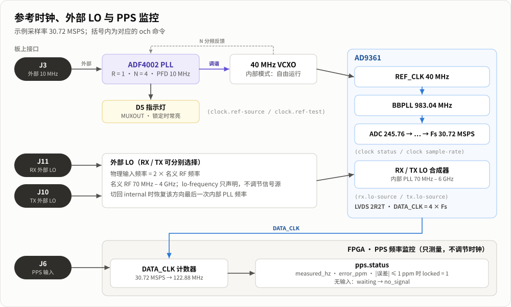

# ADF4002 参考与外部 LO（OCH 0.3.2）

原理图 `AD9361_MIX(3).pdf` 上的 ADF4002 以外部 10 MHz 为参考，调节板载 40 MHz 振荡器。AD9361 仍接收 **40 MHz**，`clock.chain` / `och_get_clock().reference_hz` 也仍为 40000000。选择外部参考不会把 AD9361 的时钟链改成 10 MHz。

## 指令

| OCH 指令 | SDK 指令 | 含义 |
|---|---|---|
| `och get clock.ref-source` | `clock_ref_source?` | 0=内部自由运行，1=ADF4002 外部 10 MHz 驯服 |
| `och set clock.ref-source internal` | `clock_ref_source=0` | 默认状态；关闭锁定指示，电荷泵三态 |
| `och set clock.ref-source external` | `clock_ref_source=1` | 开启外部参考环路；D5 由 ADF4002 数字锁定输出驱动 |
| `och get clock.ref-status` | `adf4002_status?` | 配置、GPIO 回读；有效 PPS 的频率 LOCK |
| `och action clock.ref-test` | `adf4002_self_test!` | 电荷泵三态，D5 闪三次，然后恢复测试前参考选择 |
| `och get rx.lo-source` | `rx_lo_source?` | RX 内部/外部 LO 与名义 RF 频率 |
| `och set rx.lo-source external` | `rx_lo_source=1` | 使用 RX 外部 LO 输入 |
| `och set rx.lo-source internal` | `rx_lo_source=0` | 恢复 RX 内部 PLL |
| `och get tx.lo-source` | `tx_lo_source?` | TX 内部/外部 LO 与名义 RF 频率 |
| `och set tx.lo-source external` | `tx_lo_source=1` | 使用 TX 外部 LO 输入 |
| `och set tx.lo-source internal` | `tx_lo_source=0` | 恢复 TX 内部 PLL |

`internal/external` 也接受 `0/1`。SDK 能力为 `adf4002=1`、`ref_source=1`、`external_lo=1`。CH32H417 固件和 USB 传输格式没有修改。

## 未接 10 MHz 时的通信检查

只执行 `och action clock.ref-test`，观察 D5 是否闪三次；不需要接入外部 10 MHz。测试结束恢复原选源，默认内部状态下灯回到关闭。自动结果 `gpio_verified=1` 只表示处理器 GPIO pad 回读符合输出，并不证明 ADF4002 收到了命令。

原理图的 ADF4002 MUXOUT **只接 D5，没有回到 PS/PL 输入引脚**，串行接口也没有寄存器读回。因此 SDK 原始协议报告 `chip_verified=0`、`lock_known=0 locked=-1`、`led_known=0 led_on=-1`。OCH 0.3.4 显示层隐藏这些未知 lock/LED 值，`och_reference_status.lock_known/locked` 改为 PPS 频率容差标志：有效测量在 ±1 ppm 内为锁定，超出为未锁定；关闭/没有/无效 PPS 时隐藏。不支持或查询 PPS 失败也不会阻止外部参考设置。详见 [PPS 的 LOCK 语义](pps.md#och-的-lock-显示)。`led_mode=1` 表示已配置为锁定指示，不能解读为灯已经亮或已经锁定。`visual_confirmation_required=1` 表示需要人工观察 D5 闪烁来补充芯片通信证据。

`source` 只有在 `source_known=1` 时才是已确认的配置状态。驱动故障后可能保留 `source=0 initialized=1`，但同时返回 `source_known=0 gpio_verified=0 last_error=-5`；这个 0 是缓存值，不能解释为已经安全恢复内部参考。typed getter 保留这些诊断字段。此时显式执行 `och set clock.ref-source internal` 会重新编程 ADF4002，不会当作无操作；只有 source 已知、GPIO 检查通过且没有错误时才允许同值 no-op。未知/失败状态下自检会先拒绝并要求恢复内部参考。

如果 SDK 同时将 RF 标记为未就绪，参考恢复后还需在无流对象时显式执行 `och action rf.reinit`，再重新 `configure` 和创建流；参考 setter 不会隐式执行 RF 重初始化或自动发射。

接好外部 10 MHz 后可以选 `external`。如果 ADF4002 锁定，MUXOUT 会直接点亮 D5；处理器不会据此获知锁定状态。没有外部 10 MHz 时不要用设置成功或 GPIO 回读代替锁定验收。

源设置成功不会等待无法回读的锁定状态。接入外参考后应观察 D5 确认锁定，再开始对稳定性有要求的采集。本版实测范围见 [验证记录](reference-lo-validation.md)。

## 外部 LO 与频率语义

RX/TX 独立选择，默认均为 `internal`。AD9361 的外部 LO 物理输入频率是名义 RF 频率的 **2 倍**；支持的名义 RF 范围为 70 MHz..4 GHz。内部 PLL 的原有范围仍为 70 MHz..6 GHz。输入电平和连接要求应按板卡电路及 AD9361 规格执行。

切到外部时保留当前名义 RF 频率。外部状态下的 `rx.lo-frequency` / `tx.lo-frequency` 只声明外部信号对应的名义 RF 频率供驱动使用，软件无法调节外部信号源。返回内部时恢复该方向上一次内部 PLL 频率；OCH typed setter 会读取这个频率并同步 `och_config` 缓存，后续 `configure` 不会被旧缓存误判为无操作。恢复 RX 频率涉及不同增益表时，SDK 保持原手动增益并按目标频段限幅，OCH 回读两路增益同步缓存。

`configure` 保留独立 LO source 选择，不隐式切回内部。外部选源时，频率超过 4 GHz 会在暂停已有流之前拒绝。新开 CLI 的流配置仍使用该命令的默认或显式名义频率，因此外部 LO 使用时要传入与信号源一致的 `--rx-lo-frequency` / `--tx-lo-frequency`。没有接入外部 LO 时，可以检查源选择寄存器，但不能证明收发 RF、外部信号存在或依赖外部信号的校准成功。

## 程序接口与切换边界

新增独立 ABI 1 结构，不改旧结构大小：

| C API | C++ device 方法 |
|---|---|
| `och_get_lo_source` | `lo_source()` |
| `och_set_rx_lo_source` / `och_set_tx_lo_source` | `set_rx_lo_source()` / `set_tx_lo_source()` |
| `och_get_reference_status` | `reference_status()` |
| `och_set_reference_source` | `set_reference_source()` |
| `och_test_reference` | `test_reference()` |

所有 setter 先检查能力和参数，未改变配置的请求不暂停流。实际变更、自检使用已有协调流程：暂停两方向，丢弃旧队列，执行和校验设置，恢复原来运行的方向；原来未运行的方向保持停止。RX 租借未释放则返回 `OCH_BUSY`。切换必然存在数据间断，正常丢样是预期行为；新 epoch、`RECONFIGURED` / `DISCONTINUITY` 和事件标记边界。发生写入、回读或恢复失败时停止流并使配置无效，之后重新配置和创建流。

`och_test_reference` 成功只表示 GPIO 检查和状态恢复成功，结果仍要求人工确认 LED。它不返回虚构的锁定成功或芯片读回成功。
