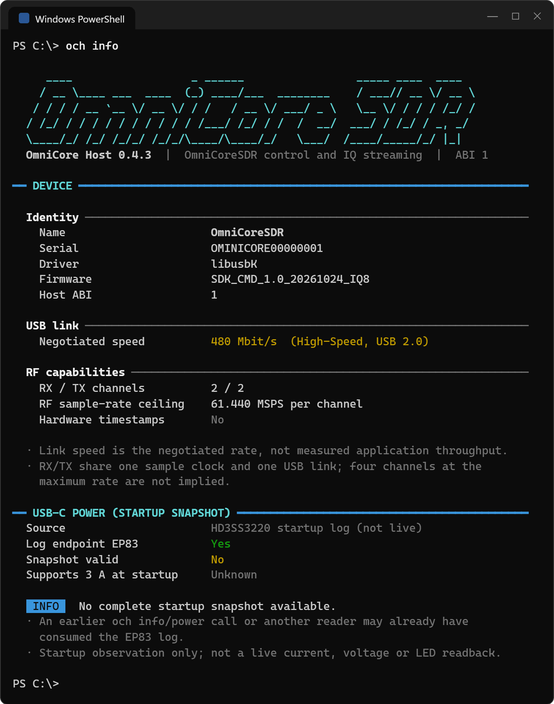
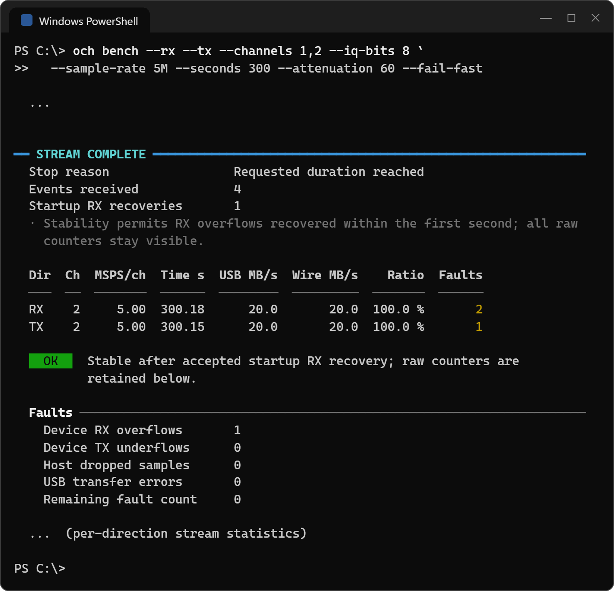

# USB2 测试结果

**2026-10-25 · OmniCore Host 0.4.3 · USB 2.0 High-Speed（480 Mbit/s）**


## 稳定传输

| 配置 | USB IQ | 稳定采样率 MSPS/通道 | RX / TX MB/s | 启动恢复 | 1 秒后新增错误 |
|---|---:|---:|---:|---:|---:|
| 1 RX | 12bit | **14** | 41.998 / — | 2 | 0 |
| 2 RX | 12bit | **7** | 41.998 / — | 0 | 0 |
| 1 TX | 12bit | **14** | — / 41.987 | 0 | 0 |
| 2 TX | 12bit | **6.5** | — / 38.988 | 0 | 0 |
| 1 RX + 1 TX | 12bit | **7** | 20.999 / 20.993 | 1 | 0 |
| 2 RX + 2 TX | 12bit | **3.5** | 20.999 / 20.993 | 0 | 0 |
| 2 RX + 2 TX | 8bit | **5** | 19.999 / 19.994 | 1 | 0 |

每项均连续运行 300 秒；单通道使用 CH1，双通道使用 CH1 + CH2，采样率为每通道。测试主机为 ThinkPad E14 Gen 7 / Core Ultra 7 255H / Windows 11（build 26200），USB 驱动为 libusbK，固件为 `SDK_CMD_1.0_20261024_IQ8`。

## 测试条件

- `bench` 使用原生 packed12 或 signed8，默认每方向 64 MiB 缓冲、32 × 196608 B USB 请求；不包含磁盘写入或应用格式转换。
- RX/TX LO 为 1 GHz、带宽 18 MHz；TX 为 1 MHz 复正弦，幅度 0.25，衰减 60 dB。
- 以 0.5 MSPS 步进选择采样率，表中为本机完成 300 秒测试的稳定档位。
- 前 1 秒内允许 RX 溢出及完整恢复，之后零新增错误；平均吞吐至少为理论 wire 速率的 98%。
- 启动溢出通知、重同步与恢复完成通知必须都在前 1 秒内被观察到，原始计数保留。任何阶段的 TX 欠流、主机丢样、传输错误、事件丢失、TX 断供或补零都不能计为通过。

`observed_seconds` 为 CLI 取出事件时的主机观察时间，从流启动调用返回后计时，不是硬件样本时间。RX/TX 共享设备故障计数，不能将双向计数相加。本次验证传输统计，未检查 RF 波形精度或位级连续性；换主机或 USB 拓扑需重新确认。

## 终端输出

USB2 与 USB3 的 `och info` 使用相同的设备信息布局。采样率表放在文档中，JSON 保留实测参考供脚本读取。



8bit 双通道全双工 5 MSPS 的 300 秒测试，启动恢复 1 次，后续零新增错误：



终端图由 CLI 自身的显示代码根据测量记录绘制，省略的段落以 `...` 标出。

## 通过记录

- [1 RX · 12bit · 14 MSPS · 300 秒](data/usb2/long300/rx1-14000000-300s.json)
- [2 RX · 12bit · 7 MSPS · 300 秒](data/usb2/grid300/rx2-7000000-300s.json)
- [1 TX · 12bit · 14 MSPS · 300 秒](data/usb2/long300/tx1-14000000-300s.json)
- [2 TX · 12bit · 6.5 MSPS · 300 秒](data/usb2/grid300/tx2-6500000-300s.json)
- [1 RX + 1 TX · 12bit · 7 MSPS · 300 秒](data/usb2/grid300/duplex1-7000000-300s.json)
- [2 RX + 2 TX · 12bit · 3.5 MSPS · 300 秒](data/usb2/grid300/duplex2-3500000-300s.json)
- [2 RX + 2 TX · 8bit · 5 MSPS · 300 秒](data/usb2/fast300/duplex8-5000000-300s.json)

[机器可读汇总](data/usb2/selected.json)保留各行证据与 SHA256；[环境记录](data/usb2/environment.json)给出主机配置。本文仅展示通过记录。

## 复现

```powershell
och bench --rx --tx --channels 1,2 --sample-rate 3.5M --seconds 300 --attenuation 60 --fail-fast
och bench --rx --tx --channels 1,2 --iq-bits 8 --sample-rate 5M --seconds 300 --attenuation 60 --fail-fast
```

`--fail-fast` 在第 1 秒之后观察到两次相隔不超过 2 秒的 RX 溢出通知时正常停流，保存统计并返回退出码 3；恢复通知不重复计数。未触发提前停止的候选继续测满请求时长。

主机安装包包含运行程序、SDK 和文档，不包含或烧写板级固件。
