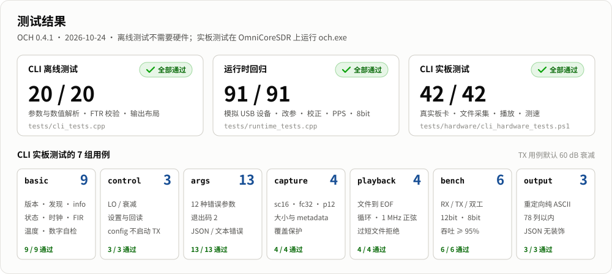
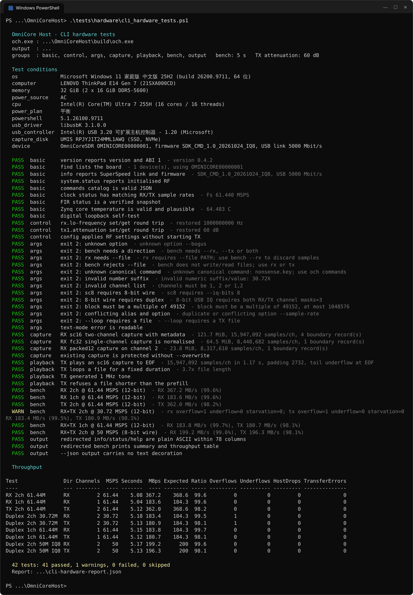

# Tests



| Suite | Source | Needs hardware | Runs on |
|---|---|---|---|
| CLI offline tests | `cli_tests.cpp` | No | Any C++17 compiler |
| Runtime regression | `runtime_tests.cpp`, `fake_device.*`, `*.inc` | No | Windows (MinGW) |
| CLI hardware tests | `hardware/cli_hardware_tests.ps1` | Yes | Windows PowerShell 5.1+ |
| IQ8 control probe | `hardware/iq8_control_probe.cpp` | Yes | Windows |
| Runtime reconfiguration | `../tools/hardware_reconfigure.cpp` | Yes | Windows |

## Offline tests

From the `OmniCoreHost` directory, with MSYS2 MinGW-w64 on `PATH`:

```powershell
cmake -S tests -B build/runtime-tests -G Ninja
cmake --build build/runtime-tests
ctest --test-dir build/runtime-tests --output-on-failure
```

On other platforms the same commands build and run only the CLI offline tests.

### CLI offline tests (20 cases)

Header-only: they include the CLI sources directly and never open a device.

| Area | What is checked |
|---|---|
| Numeric input | `k`/`M`/`G` suffixes, scientific notation; rejection of partial numbers, hex, NaN/Inf, whitespace, overflow |
| Options | flags, `--key=value`, legacy aliases, alias/option conflicts, missing or empty values, `--`, per-command allowed sets, `--no-color` |
| JSON | escaping of quotes, backslashes and control characters |
| FTR files | one- and two-column files, direction selection, mask/gain/factor/tap-count limits, control characters, profile metadata and `--coefficients-only` |
| Plain layout | every view (device, power, discovery, config, stream summary, throughput table, SDK reply, FIR, clock chain, events, help, catalog) is 7-bit ASCII and at most 78 columns |
| Styled layout | the same views with colour and Unicode enabled stay within 78 visible columns and open/reset SGR sequences in pairs; string streams are never styled |
| Verdicts | stream summary reports `OK` without faults, `WARN` for device events, `FAIL` for host loss or transfer errors |
| Views | throughput ratios, two-column status groups and fault highlighting, escaping of non-ASCII device strings, word wrapping without loss, progress line width, event severity/origin, help and catalog completeness |

### Runtime regression (91 cases)

These tests compile the production C API, configuration transaction, stream
worker, codecs, RF setters and board services against an in-process fake USB
transport (`fake_device.cpp`). They do not enumerate hardware or load libusbK;
real Windows events and threads exercise blocked transfers and concurrent
application I/O.

| Area | Coverage |
|---|---|
| Runtime reconfiguration | RX, TX and duplex restart with preserved stream handles; epoch, `RECONFIGURED` and `DISCONTINUITY` metadata; differential, no-op and invalid requests; channel-mask refusal; zero-copy lease protection; interruptible long `recv`/`send`/`flush`; zero-IQ TX prefill with stale samples discarded; idle and stopped streams stay idle; producer refill during resume; failure and resume-failure paths stop both directions; unread RX samples counted on failure |
| FIR and clock | typed operations, capability rejection and failure handling while streams run |
| RX correction | DC/IQ enable readback, preservation of the other switch, unsupported firmware, readback mismatch, malformed replies |
| Reference and LO | independent RX/TX LO source, external RF limits, restoration of the internal frequency, ADF4002 source changes, explicit unknown lock/LED state, fault-state parsing and fail-closed behaviour |
| PPS | default off, no input, valid frequency and ppm, ±1 ppm lock limits, stale/invalid/timeout suppression, stream preservation |
| Board services | RGB/fan defaults and idempotent setters, Zynq temperature unknown and fan failsafe, strict response parsing, ABI sizes |
| 8-bit USB IQ | high-bit/scaling conversion, float quantisation, framing across USB boundaries, every application format, ABI 1 defaults, capability/mask checks, tail padding, startup within the first 16 KiB packet |

The fake transport models command success/failure and ordered USB data. It does
not model AD9361 calibration time, FPGA/CH32 FIFO behaviour or RF signal
quality, so hardware tests remain necessary for timing and recovery.

## CLI hardware tests

`hardware/cli_hardware_tests.ps1` runs `och.exe` as a user would against a
connected board and checks exit codes, JSON results, files on disk and
throughput.

```powershell
# Everything, using build\och.exe and the first device found
powershell -ExecutionPolicy Bypass -File tests\hardware\cli_hardware_tests.ps1

# Selected groups, longer throughput runs
powershell -File tests\hardware\cli_hardware_tests.ps1 -Group capture,bench -BenchSeconds 30

# Installed build, receive-only
powershell -File tests\hardware\cli_hardware_tests.ps1 -Och "C:\Program Files\OmniCore Host\bin\och.exe" -SkipTx
```

| Parameter | Default | Meaning |
|---|---|---|
| `-Och` | `build\och.exe` | Executable under test |
| `-Serial` | first device | Device serial number |
| `-Group` | all | `basic`, `control`, `args`, `capture`, `playback`, `bench`, `output` |
| `-BenchSeconds` | 5 | Duration of each throughput run |
| `-TxAttenuation` | 60 | TX attenuation in dB for every transmitting test |
| `-MinThroughputRatio` | 0.95 | Pass threshold for measured / theoretical wire rate |
| `-SkipTx` | off | Skip every test that transmits |
| `-OutDir` | `%TEMP%\och-cli-tests-*` | Captures and the JSON report |
| `-KeepFiles` | off | Keep capture files after the run |

**TX tests radiate.** They run at 60 dB attenuation by default; connect a load
or antenna appropriate for your setup, or pass `-SkipTx`.

### Test cases (42)

| Group | Cases |
|---|---|
| basic | `version` reports ABI 1; `find` lists the board with 2×2 channels; `info` reports firmware, 61.44 MSPS maximum and a SuperSpeed link; `system.status` shows initialised RF and digital interface; `commands --json` is valid JSON; clock chain RX/TX sample rates match; FIR state is a verified snapshot; Zynq temperature is valid and plausible; digital loopback self-test |
| control | `rx.lo-frequency` and `tx1.attenuation` set/get round trips (original values restored); `config` applies RF settings without enabling TX |
| args | 12 invalid invocations exit with code 2 and a JSON error on stderr (unknown option, missing direction or file, bad number/channel list, `sc8` without 8-bit wire, 8-bit wire without duplex, bad block size, alias conflict, `--loop` without file); text-mode errors carry a `[FAIL]` line |
| capture | sc16 two-channel, fc32 channel 1 and packed12 channel 2 captures at 15.36 MSPS: file size equals reported samples × frame size, metadata sidecar has capture header, boundaries inside the file and a matching end record; sc16 samples are 12-bit left aligned and not all zero; fc32 samples lie within ±1; an existing capture is not overwritten without `--overwrite` |
| playback | an sc16 capture plays to EOF; `--loop` repeats the file for a fixed duration without underflow; a generated 1 MHz tone reports exactly 1 MHz; a file shorter than the four-block prefill is rejected |
| bench | RX 2ch and 1ch at 61.44 MSPS, TX 2ch at 61.44 MSPS, duplex 2ch at 30.72 MSPS, duplex 1ch at 61.44 MSPS, duplex 2ch at 50 MSPS with 8-bit wire |
| output | redirected `info`, `get system.status`, `clock status`, `fir status`, `find` and `help` are plain ASCII within 78 columns; redirected `bench` prints the summary sections and throughput table, with run/stop status on stderr; `--json` carries no decoration |

At start-up the script prints the test conditions (OS, computer, CPU, memory, power source, USB controller and driver, capture disk, device firmware) and stores them under `environment` in the JSON report.

Example run (OCH 0.4.2, 2026-10-25; ThinkPad E14 Gen 7, Core Ultra 7 255H, Windows 11 25H2, Intel USB 3.20 xHCI at 5 Gbit/s):



### Verdicts

| Result | Meaning |
|---|---|
| PASS | All assertions held |
| WARN | Passed, but something deserves attention: USB link below 5 Gbit/s, core temperature above 85 °C, throughput between `MinThroughputRatio − 5 %` and `MinThroughputRatio`, or device overflow/underflow/starvation counters during a benchmark |
| FAIL | An assertion failed; for benchmarks, any host-dropped sample, USB transfer error or event-queue drop, or throughput below `MinThroughputRatio − 5 %` |
| SKIP | Not applicable (`-SkipTx`, or a prerequisite capture is missing) |

Benchmark ratios use the average over the whole run including stream start and
stop. Tail underflow after a finite file reaches EOF is documented behaviour
and is reported in the detail text, not judged.

The script prints a coloured result list and throughput table, writes
`cli-hardware-report.json` to `-OutDir`, and exits with 1 if any case failed.
